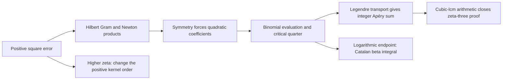

# Designing the Apéry measure: positivity, a quadratic grid, and arithmetic

The question is not merely how to verify a remarkable formula. It is: **what
requirements would lead us to look for it?** Start with a positive approximation
error, ask for explicit rational moments, and transport Legendre polynomials
through a Newton basis. Symmetry forces a quadratic grid; a binomial evaluation
and a sharp Hardy inequality then select the familiar half-squares.

This is a reconstructed design argument, with independently reviewed proofs
behind the links. The Wilson family and Prévost's irrationality argument are
classical. “Forced” below always means forced by specified design assumptions,
not unique among all possible irrationality proofs. Independently deriving
these connections does not establish historical novelty.

## 1. Design the error before designing the polynomial

Suppose a positive measure \(\nu\) on \([0,\infty)\) has infinite support
and finite rational moments of every order.
Let \(\Phi_n\) be orthogonal to every polynomial of degree below \(n\),
and choose \(z>0\), \(A=\Phi_n(-z)\ne0\). Polynomial division gives
\[
 N=\nu\!\left(\frac{A-\Phi_n(t)}{t+z}\right),\qquad
 S(z)-\frac NA
 =\frac1{A^2}\int\frac{\Phi_n(t)^2}{t+z}\,d\nu(t)>0,
 \quad S(z)=\int\frac{d\nu(t)}{t+z}.
\]
To prove the equality, subtract the two integrands and use orthogonality
against \((\Phi_n(t)-A)/(t+z)\), a polynomial of degree \(n-1\).
Rational coefficients and moments make \(N/A\) rational. The square supplies
the sign, and the estimate is \(S-N/A\le\|\Phi_n\|^2/(zA^2)\).
We now need an explicit norm, a large evaluation \(A\), and controlled
denominators. Rationality alone does not supply the last requirement.

## 2. Demand the Hilbert Gram matrix: symmetry forces the grid

Shifted Legendre polynomials are explicit and satisfy
\(\int_0^1L_n^2dx=1/(2n+1)\). The simplest way to preserve this information
is to ask for polynomials \(Q_j\), with \(Q_0=1\), satisfying
\[
 \nu(Q_jQ_k)=\frac1{j+k+1},\qquad
 tQ_j=a_jQ_{j+1}-\lambda_jQ_j,
 \quad a_j\ne0.
\]
The first is the Gram matrix of \(1,x,x^2,\ldots\) on \([0,1]\).
The second asks for a Newton product, so multiplication adds one factor.
Because multiplication by a real variable must be symmetric,
\[
 (a_j-a_k)(j+k+1)=(\lambda_j-\lambda_k)(j+k+2).
\]
Using just \(k=0,1\) forces, for every \(j\),
\[
 \boxed{a_j=a_0+cj(j+2),\qquad
 \lambda_j=\lambda_0+cj(j+1),\quad c=(a_1-a_0)/3.}
\]
Substitution verifies all remaining pairs. Conversely these relations make
the transported integral a positive polynomial moment functional: symmetry
implies \(\langle t^r,t^s\rangle=\langle1,t^{r+s}\rangle\), so its
inner product really is evaluation of polynomial products. Support on the
nonnegative half-line is an additional issue, addressed next.

Under \(Q_j\leftrightarrow x^j\), multiplication becomes the real operator
\[
 T=-c\frac d{dx}\left[x^2(1-x)\frac d{dx}\right]+a_0x-\lambda_0.
\]
We have derived an operator from a Gram matrix, rather than guessed a
special-function recurrence. The [classification proof and classical parameter
dictionary](newton-hilbert-selfadjoint-classification.md) cover necessity,
converse positivity, and the beta-weighted generalization.

## 3. Two separate choices select the half-square lattice

Ask next for the exact binomial evaluation
\[
 Q_k(-\lambda_n)=(-1)^k\binom nk\binom{n+k}k.
\]
Its \(n=k=1\) instance forces \(a_0=c\ne0\). Conversely this choice
gives \(a_j=c(j+1)^2\) and
\(\lambda_r-\lambda_n=c(r-n)(r+n+1)\), proving the full product identity.
It leaves \(\lambda_0\) free. Choose positive unit scale \(c=1\).

How far can the shift increase while multiplication stays nonnegative?
At \(\lambda_0=1/4\), integration by parts gives
\[
 \langle Tf,f\rangle
 =\frac14\int_0^1(1-x)(2xf'+f)^2dx
      +\frac14\int_0^1xf^2dx>0\quad(f\ne0).
\]
The first square suggests \(x^{-1/2}\), exactly at the boundary of square
integrability. Its finite central-binomial truncations
\[
 f_N(x)=\sum_{k=0}^N4^{-k}\binom{2k}{k}(1-x)^k
\]
satisfy \(\langle Tf_N,f_N\rangle\le3/4\) while
\(\|f_N\|^2\ge H_{N+1}\to\infty\). Thus every larger shift makes
some finite polynomial negative. The [elementary critical-quarter proof](newton-hilbert-critical-quarter.md)
shows that \(1/4\) is the **maximal** allowed shift in this chosen family.
Selecting that critical boundary yields
\[
 \lambda_j=(j+1/2)^2,\qquad
 Q_k(t)=\frac{\prod_{r=0}^{k-1}(t+(r+1/2)^2)}{(k!)^2}.
\]
The quadratic form came from symmetry; the scale relation came from binomial
evaluation; the quarter came from a maximal-positivity choice. None of these
three requirements should be silently substituted for another.

## 4. Legendre transport makes the Apéry square inevitable here

Put \(C_{n,k}=\binom nk\binom{n+k}k\). Transport
\(L_n(x)=\sum_k(-1)^kC_{n,k}x^k\) to
\(\Phi_n(t)=\sum_k(-1)^kC_{n,k}Q_k(t)\). The Gram identity gives
orthogonality and norm \(1/(2n+1)\). At its own negative grid point,
\[
 A_n=\Phi_n(-(n+1/2)^2)=\sum_{k=0}^nC_{n,k}^2\in\mathbb Z.
\]
One binomial factor came from Legendre; the other came from evaluation.
This explains the square without assuming the final Apéry sum.

The positive measure realizing these requirements is explicitly
\[
 d\nu(t)=\pi^2\operatorname{sech}^2(\pi\sqrt t)
                 \tanh(\pi\sqrt t)\,dt,\qquad
 S(z)=2\zeta(3,\sqrt z+1/2).
\]
Its moments are \((-1)^k(2k+1)B_{2k}(1/2)\), hence rational.
The [complete resolvent–Legendre proof](resolvent-legendre-pade-proof.md)
proves the measure, transform, and Gram identities by real integral and
polynomial arguments; the preceding design constraints alone do not prove
this explicit density. Evaluating at \(z=(n+1/2)^2\) gives exactly the
tail \(2(\zeta(3)-H_n^{(3)})\). Finite-product arithmetic clears the
associated numerator with \(\ell_n^3\), and Delannoy growth plus an
elementary lcm estimate completes the irrationality contradiction.

This design also explains the recurrence's cubic outer terms. In the Legendre
basis the coefficient of \(L_{n+1}\) in \(TL_n\) is
\(- (n+1)a_n/[2(2n+1)]=-(n+1)^3/[2(2n+1)]\).
To obtain the diagonal coefficients \(17\) and \(5\) one still needs the
separate adjacent balance. The [two mixed telescopes](apery-mixed-numerator-balance.md)
prove it and transfer the recurrence to the full linear form, including its
source at index zero. Gram symmetry alone does not close the diagonal.

## 5. A Catalan beta integral explains the logarithmic arithmetic

Keep the half-square grid but replace \((k!)^2\) by
\((1-\tau)_k(1+\tau)_k\), for \(0\le\tau\le1/2\).
The [reviewed logarithm–zeta deformation](logarithm-zeta3-wilson-deformation.md)
preserves the Hilbert Gram identity and reaches
\[
 Z_\tau=\sum_{r\ge1}\frac1{r(r^2-\tau^2)},\qquad
 Z_0=\zeta(3),\quad Z_{1/2}=8\log2-4.
\]
At \(\tau=1/2\), let \(J=2n+1\), \(n\ge1\). The denominator is
\[
 A_n^{\log}=\sum_{k=0}^n\frac{16^k}{2k+1}\binom{n+k}{2k}^2,
 \qquad JA_n^{\log}\in\mathbb Z.
\]
The last claim follows termwise from
\(\frac J{2k+1}\binom{n+k}{2k}
=\binom{n+k}{2k}+2\binom{n+k}{2k+1}\).
The less obvious numerator factor is exactly
\[
 H_{n,m}=\operatorname{Cat}_{m-1}
       \int_0^1x^{n-m}(1-x)^{2m-1}dx,\qquad1\le m\le n.
\]
The integrand is an integer polynomial of degree \(n+m-1\), and its
Catalan multiplier is an integer. One lcm \(\ell_J\) clears the integral.
The finite quotient expansion and harmonic contribution therefore give a
rational numerator \(B_n^{\log}\) with
\[
 J\ell_J B_n^{\log}\in\mathbb Z,\qquad
 0<J\ell_J(A_n^{\log}\log2-B_n^{\log})
 \le\frac{n+1}{4}\left(\frac{16}{17+12\sqrt2}\right)^n\to0.
\]
This proves irrationality using only \(\ell_M\le4^{M-1}\).
The [complete Catalan arithmetic proof](log2-endpoint-catalan-arithmetic.md)
has an [independent audit](log2-catalan-independent-review.md).
At \(\tau=0\), the corresponding finite-quotient coefficient is instead
\(1/(m^3C_{n,m})\), requiring the separate cubic-lcm argument.
The distinction is a proved factorial factorization, not just a change in
the appearance of the target. Catalan numbers connect this calculation to
the binary-tree case of #137. Taking limits of irrational logarithmic members
would not prove irrationality of the zeta limit.

## 6. Higher odd zeta values force a change of positive kernel

For \(m\ge1\), integral comparison gives
\[
 F_m(z)=2\zeta(2m+1,\sqrt z+1/2)\sim\frac1{mz^m}.
\]
A nonzero positive measure in a kernel \((z+t)^{-\alpha}\) has some
positive mass \(c\) on a compact interval \([0,T]\), so its transform
is at least \(c(z+T)^{-\alpha}\). Therefore **\(\alpha<m\) is impossible**
for this unmodified target. A positive ordinary resolvent cannot simply
continue the cubic argument to \(\zeta(5)\).

The [positive higher-order construction](higher-order-positive-stieltjes-zeta.md)
attains the exact order \(m\). Its density is a positive constant times
\(t^{m-1/2}(-1)^m g^{(m)}(t)\), where
\(g(t)=\operatorname{sech}^2(\pi\sqrt t)\). The product for cosh proves
complete monotonicity of \(g\); differentiation and integration by parts
then give \(F_m=\int(z+t)^{-m}d\sigma_m(t)\), mass \(1/m\), and rational
moments. Gaussian and zero-node Radau rules produce
[reviewed strictly nested rational bounds](nested-higher-zeta-radau-independent-review.md)
with width \(O_m(n^{-1/2}(2/(\pi e))^{4n})\).
Their reduced denominators remain uncontrolled at the scale needed for
irrationality. This is a complete approximation theorem, not an all-odd proof.

The [real-order extension](real-order-positive-stieltjes-zeta.md) connects
the normalized measures by beta products. Its common mixing law has Laplace
transform \(g(t)\): it is exactly the classical Pitman–Yor variable
\((\pi^2/2)C_2\), equivalently a sum of two suitably scaled Brownian exit
times. This explains positivity through probability; Brownian theory is
optional, and neither it nor rational moments supplies missing denominators.

## A focused reading route and attribution

For the 40-hour team, keep 32 hours on #131 and 8 on #137. Read this design
guide first, then the complete resolvent–Legendre proof and the mixed
telescopes. Use the existing [Zudilin discovery guide](discovery-guide.md)
to preserve the original proof sequence and official recurrence goal.
Choose the Catalan endpoint as the short extension: deliver a two-page
arithmetic proof and one worked example, \(B_1^{\log}/A_1^{\log}=79/114\).
Use the higher-order obstruction as a final slide identifying the next task:
prove a sufficiently strong denominator bound for a specified approximation.
The beta/Brownian interpretation can remain an optional appendix.

Credit Prévost (1996) for the Wilson–Padé irrationality route; Wilson
polynomials and the exact Ismail–Koelink operator match are documented in the
classification note. Pitman–Yor (2003), equation (1), is the exact source for
the hyperbolic probability law; generalized Stieltjes order is classical
Karp–Prilepkina theory. The [primary-source comparison](generalized-stieltjes-primary-comparison.md)
separates these established ingredients from the independently developed
centered-Hurwitz constructions. Their historical priority remains unresolved.
The achievement recorded here is a chain of proved design constraints and
explicit arithmetic mechanisms, with the remaining denominator problem stated.
