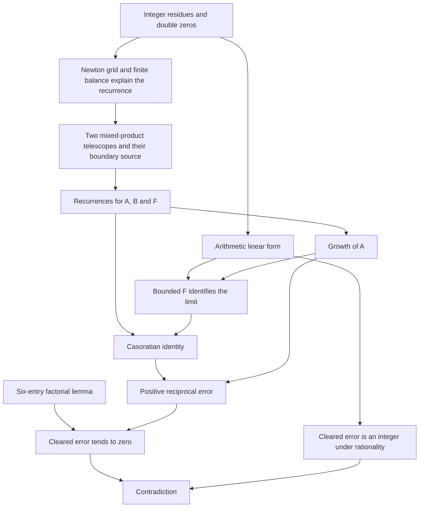

# Discovering the mechanism behind Apéry’s proof

*A living mathematical exposition for the Mathathon team.*

The goal is to explain why the ingredients of Apéry’s proof fit together, then give a complete elementary proof. The integer residues lead to a quadratic Newton grid and a finite balance law that derive the recurrence’s coefficients. Two short rational identities transfer that balance to the entire linear form. A rough bound identifies the zeta-valued limit; the recurrence then supplies positive, exponentially small error. No saddle-point theorem is needed.

A second exact bridge explains the reciprocal scales: the same positive Laurent polynomial produces the integer \(A_n\) as the constant term of its \(n\)-th power and the Beukers error integral as a real integral of its \((-n-1)\)-st power. One elementary minimization controls both. We introduce that polynomial with the integer sequence, then return to it when the integral representation is available.

This is a simplification assembled from classical Apéry-type ingredients, not a claim of a historically new proof. The explanations of how one might discover the ingredients are mathematical reconstructions. They are not claims about the private reasoning of Apéry, Zudilin, or Beukers. The principal source is [Zudilin’s original paper](https://arxiv.org/abs/math/0202159); [the companion exposition](zudilin-explained.md) follows its seven lemmas individually. All normalizations used here are explicit.

## 1. Design the contradiction before choosing the formula

A rational number cannot be too close to an integer in an arithmetic lattice whose spacing we know. More precisely, suppose

\[
A_n\in\mathbb Z,\qquad D_n^3B_n\in\mathbb Z,
\qquad D_n=\operatorname{lcm}(1,\ldots,n),
\]

with the convention \(D_0=1\), and

\[
0<D_n^3(A_n\alpha-B_n)\longrightarrow0.
\]

Then \(\alpha\) is irrational. Indeed, if \(\alpha=p/q\), the expression
\(qD_n^3(A_n\alpha-B_n)\) is a positive integer tending to zero.

This target has three independent requirements: controlled denominators, nonvanishing, and decay after denominators are cleared. A spectacular decimal approximation may satisfy none of them. The auxiliary function must be designed to serve all three.

For \(\zeta(3)\), summing a cubic pole over positive integers is natural:

\[
\sum_{t=1}^{\infty}\frac1{(t+k)^3}
 =\zeta(3)-H_k^{(3)},
\qquad H_k^{(r)}=\sum_{j=1}^k j^{-r}.
\]

Thus we want cubic poles at nonpositive integers. Rather than construct them directly, we will differentiate a square of a simple-pole function. This gives cubic poles while making their coefficients integral squares. The remaining lower-order poles will cancel for a structural reason.

## 2. Zeros and poles force the auxiliary product

The square need not be guessed. For \(n\ge1\), require a rational function with poles only at \(0,-1,\ldots,-n\), each of order at most two, with quadratic decay at infinity and double zeros at \(1,\ldots,n\). Multiplication by \([t(t+1)\cdots(t+n)]^2\) leaves a polynomial of degree at most \(2n\). Its prescribed double zeros already account for \(2n\) roots. Therefore it is a constant multiple of \([(t-1)\cdots(t-n)]^2\). Normalizing the leading coefficient to one forces

\[
P_n(t)=\frac{(t-1)\cdots(t-n)}{t(t+1)\cdots(t+n)},
\qquad R_n(t)=P_n(t)^2.
\tag{1}
\]

For \(n=0\), use the empty-product convention. Thus the square follows from a saturated interpolation problem: every available degree has a job. For a nonzero function, this also uses the fewest possible double poles. With \(M\) such poles and quadratic decay, the numerator has degree at most \(2M-2\); the \(n\) double zeros require \(M\ge n+1\).

These statements classify the specified constraints, not all possible auxiliary constructions. Their purpose is to explain why the formula becomes inevitable once this design has been chosen. Its normalization is especially useful because all residues are integers:

\[
P_n(t)=\sum_{k=0}^{n}\frac{c_{n,k}}{t+k},
\qquad
c_{n,k}=(-1)^{n-k}\binom nk\binom{n+k}{k}.
\tag{2}
\]

To check (2), multiply by \(t+k\) and substitute \(t=-k\). Both sides then have the same residues, and their difference is a rational function without poles that vanishes at infinity.

Why these particular features? The integral pole lattice controls denominators through differences \(k-\ell\). The positive integer zeros suppress the first summands. Squaring makes these zeros double, so they remain zeros after one differentiation. The function also decays as \(t^{-2}\), which will cancel an unwanted zeta coefficient.

These are simultaneous design decisions, not decorative features of an already-known answer.

The balanced product has an exact symmetry worth distinguishing from a tempting false one. If \(B_n(t)=tP_n(t)\), then

\[
B_n(-t)=B_n(t)^{-1},\qquad R_n(t)R_n(-t)=t^{-4}.
\]

It does **not** obey \(R_n(-n-t)=R_n(t)\). Each factor \((z-j)/(z+j)\) has modulus one on the imaginary axis and less than one in the right half-plane, because \(|z+j|^2-|z-j|^2=4j\operatorname{Re}z\). Thus the same product is a finite rational inner function after multiplication by \(t\). This supplies a complex-analytic interpretation of its size balance; the elementary proof below needs only its real product formula.

## 3. The arithmetic is easiest before simplifying the formula

Squaring (2), write

\[
R_n(t)=\sum_{k=0}^{n}
 \left(\frac{a_{n,k}}{(t+k)^2}+\frac{b_{n,k}}{t+k}\right).
\]

The identity

\[
\frac1{(t+k)(t+\ell)}
 =\frac1{\ell-k}\left(\frac1{t+k}-\frac1{t+\ell}\right)
\]

immediately gives

\[
a_{n,k}=c_{n,k}^2,\qquad
\frac{b_{n,k}}2=c_{n,k}\sum_{\ell\ne k}\frac{c_{n,\ell}}{\ell-k}.
\tag{3}
\]

Consequently

\[
a_{n,k}\in\mathbb Z,\qquad
D_n\frac{b_{n,k}}2\in\mathbb Z.
\tag{4}
\]

The consecutive lattice is optimal for this particular denominator mechanism. If \(b_0,\ldots,b_n\) are distinct integers and

\[
L=\operatorname{lcm}_{i<j}|b_i-b_j|,
\]

then \(D_n\mid L\). Indeed, for every prime power \(p^e\le n\), two of the \(n+1\) positions occupy the same residue class modulo \(p^e\); their nonzero difference supplies that prime power. Consecutive positions attain \(L=D_n\). More precisely, the least multiplier clearing the simple-pole coefficients of a square for **all integer residue vectors** is \(L/\gcd(L,2)\), since those coefficients contain \(2/(b_i-b_j)\). The consecutive lattice minimizes this sharper multiplier too. Special residues may admit further cancellation, so this is not a global optimality claim about irrationality proofs.

Only differences between pole locations occur. An alternative logarithmic-derivative formula introduces harmonic numbers as large as \(H_{n+k}\), making the same denominator fact look mysterious. Formula (3) exposes the cancellation before it needs to be proved.

Because \(R_n(t)=O(t^{-2})\), its coefficient of \(t^{-1}\) at infinity is zero. Hence

\[
\sum_{k=0}^{n}b_{n,k}=0.
\tag{5}
\]

Define

\[
F_n=-\sum_{t=1}^{\infty}R_n'(t).
\tag{6}
\]

Differentiation and summation of the finite partial fractions are legitimate: the resulting series converge absolutely. Equations (3)–(5) yield

\[
F_n=2\bigl(A_n\zeta(3)-B_n\bigr),
\tag{7}
\]

where

\[
A_n=\sum_{k=0}^{n}c_{n,k}^2,
\qquad
B_n=\sum_{k=0}^{n}
 \left(a_{n,k}H_k^{(3)}+\frac{b_{n,k}}2H_k^{(2)}\right).
\tag{8}
\]

The possible \(\zeta(2)\) coefficient is \(\frac12\sum b_{n,k}=0\). Since \(D_n^rH_k^{(r)}\) is integral for \(k\le n\), we have proved

\[
A_n\in\mathbb Z,\qquad D_n^3B_n\in\mathbb Z.
\tag{9}
\]

The initial values are

\[
(A_0,A_1)=(1,5),\qquad(B_0,B_1)=(0,6).
\tag{10}
\]

The arithmetic half of the proof is now complete. We have not assumed irrationality or positivity.

### The same integers are constant terms of one positive polynomial

A Laurent polynomial allows negative integer powers of its variables; \(\operatorname{CT}\) denotes its constant coefficient. The binomial sum in (8) has the useful representation

\[
\boxed{\quad
\Lambda(x,y,z)=
\frac{(1+x)(1+y)(1+z)\bigl((1+x)(1+y)+xyz\bigr)}{xyz},
\qquad A_n=\operatorname{CT}_{x,y,z}\Lambda^n.
\quad}
\]

This can be discovered systematically. Leave one factor \(\binom nj\) in the sum, and express the other three binomial factors by independent coefficient extractions. Writing \(U=(1+x)(1+y)\), the binomial theorem gives

\[
\begin{aligned}
A_n
&=\operatorname{CT}_{x,y,z}
 U^n(1+z)^n\sum_{j=0}^n\binom nj
       \left(\frac{U}{xyz}\right)^j\\
&=\operatorname{CT}_{x,y,z}
 \left[U(1+z)\left(1+\frac{U}{xyz}\right)\right]^n
 =\operatorname{CT}\Lambda^n.
\end{aligned}
\]

For each \(j\), extraction in \(x,y,z\) supplies respectively
\(\binom{n+j}{j},\binom{n+j}{j},\binom nj\), exactly the missing factors.
Everything is finite algebra. The expanded \(\Lambda\) has nonnegative integer coefficients, so integrality is visible. Equivalently, \(A_n\) counts closed walks with its exponent vectors as steps, each coefficient recording the number of colors of that step.

Why introduce this language? Its reciprocal will be precisely the positive kernel in Beukers’ integral, recording both sides of the approximation in one object. First, the residue coefficients themselves give the most direct explanation of the recurrence.

## 4. Discover the recurrence from the coefficients, then certify it for the linear form

### A quadratic interpolation grid explains the cubic coefficients

The absolute values of the residues in (2) are

\[
\phi_k(n)=\binom nk\binom{n+k}{k}
 =\frac1{(k!)^2}\prod_{j=0}^{k-1}\bigl[n(n+1)-j(j+1)\bigr].
\]

So they are Newton interpolation polynomials on the quadratic grid \(0,2,6,12,\ldots\). Multiplication by \(z=n(n+1)\) adds the next zero:

\[
z\phi_k=k(k+1)\phi_k+(k+1)^2\phi_{k+1}.
\]

We want a symmetric kernel \(\sum_k\phi_k(n)\phi_k(m)\). Multiplication on one factor will match a **transposed** rule on the other if we find an operator with

\[
\mathcal L\phi_k=k(k+1)\phi_k+k^2\phi_{k-1}.
\]

Look for nearest-neighbor differences
\(\mathcal Lf=\alpha(n)[f(n+1)-f(n)]+\beta(n)[f(n-1)-f(n)]\).
Imposing the desired rule on just \(\phi_1=z\) and \(\phi_2=z(z-2)/4\) gives two linear equations. For \(n\ge1\) their unique solution is

\[
(\mathcal Lf)(n)=
\frac{(n+1)^3[f(n+1)-f(n)]+n^3[f(n-1)-f(n)]}{2(2n+1)}.
\]

At zero the backward coefficient is zero. The candidate works on every \(\phi_k\): substitute
\(\phi_k(n+1)/\phi_k(n)=(n+k+1)/(n-k+1)\) and
\(\phi_k(n-1)/\phi_k(n)=(n-k)/(n+k)\), then cancel. The resulting polynomial identity remains valid at the apparent exceptional indices and includes \(k=0\), where the lowering term is absent.

Define

\[
K(n,m)=\sum_{k=0}^{\min(n,m)}\phi_k(n)\phi_k(m),
\qquad A_n=K(n,n).
\]

For fixed \(m\), write the sum through \(m\); it is one polynomial in \(n\), so no moving summation boundary is lost. The transposed rule proves
\(\mathcal L_nK(n,m)=m(m+1)K(n,m)\), or

\[
(n+1)^3K(n+1,m)+n^3K(n-1,m)
=(2n+1)[n(n+1)+2m(m+1)+1]K(n,m).
\]

This explains the cubes. It does not yet give a diagonal recurrence: \(K(n+1,n)\) is not \(A_{n+1}\). We need one more identity, and it explains the integers \(17\) and \(5\).

### A finite balance law explains the coefficient six

For \(n\ge1\), set

\[
c_k=\frac{n\phi_k(n)}{n+k},\qquad w_k=c_k^2\quad(0\le k\le n),
\qquad w_{n+1}=0.
\]

The factorial ratio gives the exact edge balance

\[
w_k(n^2-k^2)^2=(k+1)^4w_{k+1}.
\]

Sum over \(k=0,\ldots,n\) and shift the finite index on the right. The terms in \(k^4\) cancel, leaving

\[
\sum_{k=0}^n k^2w_k=\frac{n^2}{2}\sum_{k=0}^n w_k.
\]

No probability theorem is needed. If desired, this is detailed balance for a finite birth–death chain, whose stationary weights are \(w_k\). Its exact mean square index is \(n^2/2\), explaining the location \(n/\sqrt2\) that also appears in saddle calculations.

Now \(\phi_k(n)=c_k(1+k/n)\) and \(\phi_k(n-1)=c_k(1-k/n)\). Therefore

\[
A_n+A_{n-1}=3\sum_kw_k,
\qquad K(n,n-1)=\frac12\sum_kw_k,
\qquad
\boxed{A_n+A_{n-1}=6K(n,n-1).}
\]

Apply the two-variable recurrence at \((n,n)\), and replace its two adjacent-diagonal terms using this identity and symmetry. The middle coefficient becomes

\[
\begin{aligned}
&6(2n+1)[3n(n+1)+1]-(n+1)^3-n^3\\
&\hspace{2em}=(2n+1)[17n(n+1)+5].
\end{aligned}
\]

Thus the Apéry recurrence for \(A_n\) follows directly from its integer residues. The constants are \(17=6\cdot3-1\) and \(5=6\cdot1-1\): the coefficient six comes from finite balance, and the subtraction comes from removing the diagonal contributions in a difference operator. The [Newton-basis derivation](newton-bispectral-motivation.md) and [independent review](newton-symmetric-square-review.md) give further details and a Legendre-polynomial connection.

### Two mixed products transfer the recurrence to the entire linear form

The recurrence for \(A_n\) alone does not prove it for \(B_n\). To transfer the same mechanism, temporarily separate the two equal factors in \(R_n=P_n^2\):

\[
P_n(t)=\frac{\prod_{j=1}^n(t-j)}{\prod_{j=0}^n(t+j)},\qquad
S_{n,m}(t)=(-1)^{n+m}P_n(t)P_m(t),\qquad
\mathcal E_{n,m}=-\frac12\sum_{t=1}^{\infty}S_{n,m}'(t).
\]

The sign makes the sum of double-pole coefficients of \(S_{n,m}\) equal to \(K(n,m)\). The mixed forms are symmetric in \(n,m\), and our original normalization is \(F_n=2\mathcal E_{n,n}\). Their sums converge absolutely because \(S_{n,m}'(t)=O(t^{-3})\).

The product ratios now have simple poles instead of double poles. Put \(Q_{n,m}(t)=(t-m-1)(t+m)S_{n,m}(t)\). The first identity is

\[
\begin{aligned}
 &(n+1)^3S_{n+1,m}
 -(2n+1)[n(n+1)+2m(m+1)+1]S_{n,m}
 +n^3S_{n-1,m}\\
 &\hspace{2em}=-2(2n+1)\bigl[Q_{n,m}(t+1)-Q_{n,m}(t)\bigr].
\end{aligned}
\tag{11}
\]

It holds for \(n,m\ge0\), omitting the backward term at \(n=0\). Here is its entire algebraic check. Write \(N=n(n+1)\), \(M=m(m+1)\), divide by \(S_{n,m}\), and multiply by \((t-n)(t+n+1)\). The right side becomes \(-2(2n+1)\) times

\[
t^4-(t^2+t-N)(t^2-t-M)
=(N+M+1)t^2+(M-N)t-NM.
\]

The left side becomes

\[
\begin{aligned}
&-(n+1)^3(t-n-1)(t-n)\\
&\quad -(2n+1)(N+2M+1)(t-n)(t+n+1)
-n^3(t+n)(t+n+1),
\end{aligned}
\]

whose three coefficients are exactly the same. These rational identities remain valid at zeros of the ratios after cancellation.

For \(n\ge1\), differentiating (11) and summing makes its right side vanish. At infinity \(Q'=O(t^{-2})\). At \(1\), either \(m\ge1\) and the product has a double zero, or \(m=0\) and the factor \(t-1\) in \(Q\) supplies the second zero. Thus \(\mathcal E_{n,m}\) obeys the same mixed recurrence as \(K(n,m)\).

To close its diagonal, we need the counterpart of the coefficient six. It is another short rational identity:

\[
\boxed{
P_n(t)^2+P_{n-1}(t)^2+6P_n(t)P_{n-1}(t)
=T_n(t+1)-T_n(t),\quad
T_n(t)=\frac4{n^2}(t+n)^2P_n(t)^2.
}
\tag{12}
\]

For a direct check, set \(r(t)=P_n(t)^2/(t-n)^2\). The left side is \(4(2t^2-n^2)r(t)\). The right side is
\(4[t^4-(t^2-n^2)^2]r(t)/n^2\), the same expression. This identity requires \(n\ge1\). Both derivative endpoints vanish, including at \(n=1\), where \(T_1(t)=4(t-1)^2/t^2\). Since \(S_{n,n-1}=-P_nP_{n-1}\), differentiation and summation give

\[
\mathcal E_{n,n}+\mathcal E_{n-1,n-1}=6\mathcal E_{n,n-1}.
\]

Now set \(m=n\) in the mixed recurrence, use symmetry, and replace both off-diagonal terms by these adjacent averages. If \(e_n=\mathcal E_{n,n}\), the result is

\[
(n+1)^3\frac{e_{n+1}+e_n}{6}
-(2n+1)[3n(n+1)+1]e_n
+n^3\frac{e_n+e_{n-1}}6=0.
\]

The same calculation as for \(A_n\) therefore proves

\[
\boxed{
(n+1)^3F_{n+1}-\beta_nF_n+n^3F_{n-1}=0,\qquad n\ge1,
\quad \beta_n=(2n+1)(17n^2+17n+5).
}
\tag{13}
\]

There is a boundary source at zero, and it must be kept. Direct evaluation gives \(Q_{0,m}'(1)=1\) for every \(m\ge0\): for \(m=0\), \(Q=(t-1)/t\); for \(m\ge1\), use \(P_m'(1)=(-1)^{m-1}/[m(m+1)]\). Thus

\[
\mathcal E_{1,m}-[2m(m+1)+1]\mathcal E_{0,m}=-1.
\]

Starting from \(\mathcal E_{0,0}=\zeta(3)\), this gives
\(\mathcal E_{0,1}=\zeta(3)-1\) and
\(\mathcal E_{1,1}=5\zeta(3)-6\).
In our normalization, \(F_0=2\zeta(3)\) and \(F_1=10\zeta(3)-12\).

A logical point matters: we cannot yet equate rational and \(\zeta(3)\) coefficients in (13). The Newton argument independently proves the recurrence for \(A_n\); equation (7) then proves it for \(B_n\). There is also a fully rational shortcut to the denominator argument: summing double-pole coefficients in (11) gives the mixed recurrence for \(K\), and doing the same in (12) gives \(A_n+A_{n-1}=6K(n,n-1)\). Translation preserves these sums, so no irrationality assumption enters.

This is why the same six governs denominator and numerator: one finite difference yields both balances under two different linear operations. The [full mixed-product proof](apery-mixed-numerator-balance.md), with [independent review](apery-mixed-numerator-independent-review.md), also identifies its associated numerator through an elementary Bernoulli functional. [Appendix A](#appendix-a-the-direct-diagonal-certificate-by-pole-matching) preserves the alternative direct diagonal certificate, useful for testing higher derivatives.

## 5. A rough estimate is enough to identify the limit

For integer \(1\le t\le n\), we have \(R_n'(t)=0\). For integer \(t>n\), each ratio \((t-j)/(t+j)\) lies in \((0,1)\), so

\[
0<R_n(t)\le t^{-2}.
\]

Logarithmic differentiation gives the deliberately crude bound

\[
|R_n'(t)|
\le2R_n(t)\left(\sum_{j=1}^n\frac1{t-j}
                +\sum_{j=0}^n\frac1{t+j}\right)
\le\frac{4n+2}{t^2}.
\]

Every denominator here is a positive integer. Therefore, for \(n\ge1\),

\[
|F_n|\le(4n+2)\sum_{t=n+1}^{\infty}t^{-2}
       \le4+\frac2n.
\tag{14}
\]

This does not prove that \(F_n\) is small. It proves something easier that will be enough for now.

Put \(r_n=A_n/A_{n-1}\). The recurrence gives

\[
r_{n+1}=\frac{\beta_n-n^3/r_n}{(n+1)^3}.
\]

Starting with \(r_1=5\), induction shows \(r_n\ge5\), because

\[
5\beta_n-n^3-25(n+1)^3
 =144n^3+180n^2+60n\ge0.
\]

Hence \(A_n\ge5^n\). Combining this with (7) and (14),

\[
\frac{B_n}{A_n}\longrightarrow\zeta(3).
\tag{15}
\]

The strategy has separated identification from error estimation. We first establish the correct limiting constant using a bounded numerator and a growing denominator. We then let the recurrence determine the error.

## 6. A two-by-two determinant supplies positivity and decay

Define the discrete Wronskian, also called a Casoratian,

\[
W_n=A_nB_{n+1}-A_{n+1}B_n.
\]

Substitution of the recurrence gives

\[
W_n=\frac{n^3}{(n+1)^3}W_{n-1}.
\]

Since \(W_0=6\),

\[
W_n=\frac6{(n+1)^3}.
\tag{16}
\]

Divide by \(A_nA_{n+1}\), sum from \(n\) to infinity, and use (15):

\[
\zeta(3)-\frac{B_n}{A_n}
 =6\sum_{j=n}^{\infty}\frac1{(j+1)^3A_jA_{j+1}}>0.
\tag{17}
\]

This proves nonvanishing and its sign. Moreover \(A_{n+k}\ge5^kA_n\), so

\[
0<A_n\zeta(3)-B_n
 \le\frac6{(n+1)^3A_n}
       \sum_{k=0}^{\infty}5^{-2k-1}
 =\frac5{4(n+1)^3A_n}.
\tag{18}
\]

Growth of one solution has produced reciprocal decay of the complementary solution. A second-order recurrence has two dimensions of solutions; after the growing component is cancelled, the determinant identity controls what remains. Section 9 will reveal the same reciprocity directly: positive powers of \(\Lambda\) create the integer sequence, while inverse powers create the small integral.

### The determinant identity is Kirchhoff's law

There is an exact physical interpretation of (17). Put a conductance

\[
c_n=(n+1)^3A_nA_{n+1}
\]

on the edge from \(n\) to \(n+1\), with resistance \(\rho_n=1/c_n\). If \(u_n=A_nv_n\) solves the recurrence, subtraction of the recurrence for \(A_n\) gives

\[
c_n(v_{n+1}-v_n)=c_{n-1}(v_n-v_{n-1}).
\]

The current is constant along the chain. For \(u=B\), its value is \(c_0(B_1/A_1-B_0/A_0)=6\). Thus

\[
\frac{B_n}{A_n}=6\sum_{j<n}\rho_j,\qquad
\frac{\zeta(3)}6=\sum_{j\ge0}\rho_j,
\qquad
A_n\zeta(3)-B_n=6A_n\sum_{j\ge n}\rho_j.
\]

The approximation error is the resistance of the omitted tail. Its sign and size are consequences of positive resistances and increasing conductances. The identification of the total resistance with \(\zeta(3)/6\) still uses (15); electrical terminology does not identify that constant by itself.

The same substitution yields a sharp inequality. For every finitely supported real sequence \(f\),

\[
\begin{aligned}
\mathcal Q(f)
&:=\sum_{n\ge0}\beta_nf_n^2
 -2\sum_{n\ge0}(n+1)^3f_nf_{n+1}\\
&=\sum_{n\ge0}c_n
 \left(\frac{f_n}{A_n}-\frac{f_{n+1}}{A_{n+1}}\right)^2
 \ge\frac6{\zeta(3)}f_0^2.
\end{aligned}
\]

Expansion proves the equality using the recurrence for \(A_n\). Weighted Cauchy–Schwarz proves the inequality: the voltage drops telescope to \(f_0\), and the sum of their resistance weights is \(\zeta(3)/6\). To see sharpness, choose on \(0\le n\le N\) the voltage
\(v_n=\sum_{j=n}^N\rho_j/\sum_{j=0}^N\rho_j\), and zero afterwards; then \(f_n=A_nv_n\) has energy \(1/\sum_{j=0}^N\rho_j\), tending to \(6/\zeta(3)\).

This is a useful theorem obtained from the proof, not an extra prerequisite for it. Positive finite energy also makes every finite recurrence matrix positive definite, explaining the positivity of its continued-fraction pivots. The [network derivation](discrete-green-motivation.md) and [independent review](discrete-green-independent-review.md) give its full Green kernel and the required boundary conditions for infinite minimizers.

## 7. Prove only the growth estimate the arithmetic requires

There is no need to calculate a sharp asymptotic. The exact decomposition

\[
\frac{\beta_n}{(n+1)^3}
 =34-\frac{51}{n+1}+\frac{27n+22}{(n+1)^3}
\]

and \(r_n\ge5\) give

\[
r_{n+1}>\frac{169}{5}-\frac{51}{n+1}.
\]

For \(n\ge1019\), this is at least \(Q=135/4\). Therefore some fixed \(C>0\) satisfies

\[
A_n\ge C Q^n\qquad(n\ge1019).
\tag{19}
\]

The cutoff is intentionally crude. Irrationality needs an eventual exponential advantage, not an efficient numerical approximation algorithm.

We next prove the matching arithmetic estimate rather than silently invoking the prime number theorem.

**Elementary denominator lemma.**

\[
\log D_n\le cn+O(\log^2(n+1)),
\qquad c=\frac12\log2+\frac34\log3.
\tag{20}
\]

For real \(x\ge1\), put \(\psi(x)=\log D_{\lfloor x\rfloor}\), and consider

\[
\mathcal L(x)=\log(\lfloor x\rfloor!)
 -\log(\lfloor x/2\rfloor!)
 -2\log(\lfloor x/3\rfloor!)
 +\log(\lfloor x/6\rfloor!).
\]

Counting multiples of each prime power in a factorial gives

\[
\mathcal L(x)=\sum_{p\text{ prime},\ a\ge1}
 h(x/p^a)\log p,
\quad
h(y)=\lfloor y\rfloor-\lfloor y/2\rfloor
             -2\lfloor y/3\rfloor+\lfloor y/6\rfloor.
\]

The function \(h\) has period six. Its values on the intervals \([j,j+1)\) are

| \(j\) | 0 | 1 | 2 | 3 | 4 | 5 |
|---|---:|---:|---:|---:|---:|---:|
| \(h\) | 0 | 1 | 1 | 0 | 0 | 1 |

Thus \(h\ge0\) and \(h=1\) on \([1,3)\). Every prime power in \((x/3,x]\) contributes to \(\mathcal L(x)\), proving

\[
\psi(x)-\psi(x/3)\le\mathcal L(x).
\]

The integral comparison for the increasing function \(\log t\) gives
\(\log(m!)=m\log m-m+O(\log(m+1))\). Applying it at the four fixed scales,

\[
\mathcal L(x)=\left(\frac13\log2+\frac12\log3\right)x
              +O(\log(x+1)).
\]

The terms in \(x\log x\) and \(x\) cancel because
\(1-1/2-2/3+1/6=0\). Iterating the inequality for \(\psi\) gives a geometric sum with factor \(3/2\), and at most \(O(\log x)\) error terms of size \(O(\log x)\). This proves (20).

The design of this lemma mirrors the rest of the proof. Choose a balanced factorial ratio so large terms cancel; keep its prime valuations nonnegative; make it capture a fixed interval of prime powers. A six-entry table certifies all of this.

## 8. The contradiction

The necessary strict comparison contains no uncertain decimal calculation:

\[
\frac{Q^4}{e^{12c}}=\frac{16875}{16384}>1.
\tag{21}
\]

Hence \(e^{3c}<Q\). Equations (18)–(20) imply

\[
0<D_n^3(A_n\zeta(3)-B_n)
 \le\frac{5D_n^3}{4(n+1)^3A_n}\longrightarrow0.
\]

If \(\zeta(3)=p/q\), multiplying by \(q\) produces a positive integer tending to zero, impossible. Therefore

\[
\boxed{\zeta(3)\text{ is irrational}.}
\]

No saddle-point theorem, prime number theorem, or special-function identity was used in this proof; the supplementary gamma-function notation below plays no role in it. Its analytic inputs were convergence of elementary series and the integral comparison for \(\log(m!)\). Its central new organizational choice was to identify the limit cheaply, then use the recurrence to obtain the strong error bound.

## 9. The Laurent polynomial connects the integer sequence and the small integral

We now connect the Laurent constant-term formula to the error, without assuming that a shared recurrence alone identifies a constant. The bridge begins with the shifted Legendre polynomial

\[
\mathcal P_n(x)=\frac1{n!}\frac{d^n}{dx^n}[x^n(1-x)^n].
\]

Its Mellin transform is

\[
\int_0^1x^{t-1}\mathcal P_n(x)\,dx=(-1)^nP_n(t).
\tag{22}
\]

For \(t>n\), this follows by \(n\) integrations by parts and the beta integral. Both sides are rational functions of \(t\), so the identity holds wherever defined, in particular for \(t>0\). Orthogonality gives another discovery explanation: \(\int_0^1x^{j-1}\mathcal P_n(x)\,dx=0\) for \(j=1,\ldots,n\). Those are precisely the prescribed numerator zeros.

Squaring (22), differentiating in \(t\), and summing gives

\[
F_n=\int_0^1\!\int_0^1
 \mathcal P_n(x)\mathcal P_n(y)
 \frac{-\log(xy)}{1-xy}\,dx\,dy.
\tag{23}
\]

Boundedness of the polynomials and integrability of the logarithmic kernel justify the exchanges. The residues of the Mellin transform are the polynomial coefficients; squaring them produces the same \(A_n\) in either language.

The integrand in (23) changes sign. Beukers turns it into a positive one:

\[
F_n=\int_{[0,1]^3}
 \frac{[x(1-x)y(1-y)z(1-z)]^n}
      {(1-z+xyz)^{n+1}}\,dx\,dy\,dz.
\tag{24}
\]

The useful substitution is designed, not guessed after the fact. First express the logarithmic kernel as \(\int_0^1(1-z+xyz)^{-1}\,dz\), then integrate by parts in \(x\). Before integrating by parts in \(y\), make

\[
w=\frac{1-z}{1-z+xyz}.
\]

This removes the unwanted \(y^n\) factor from the kernel. A second integration by parts now produces (24). The explicit Jacobian, endpoint conditions, and absolute-integrability justification are in [the integral proof](beukers-explained.md).

### The reciprocal change of variables

Call the cube variables in (24) \(a,b,c\), and substitute

\[
a=\frac{x}{1+x},\qquad b=\frac{y}{1+y},\qquad
c=\frac{z}{1+z},\qquad x,y,z>0.
\]

This bijection turns endpoint factors into monomials. With \(U=(1+x)(1+y)\),

\[
\mathcal Q:=1-c+abc=\frac{U+xyz}{U(1+z)},\qquad
h:=\frac{a(1-a)b(1-b)c(1-c)}{\mathcal Q}=\frac1{\Lambda(x,y,z)}.
\]

The measure is just as important as the kernel. Its Jacobian is
\(da\,db\,dc=dx\,dy\,dz/[U^2(1+z)^2]\), and hence

\[
\frac{da\,db\,dc}{\mathcal Q}
 =\frac1{\Lambda(x,y,z)}\frac{dx\,dy\,dz}{xyz}.
\]

Thus the two objects have the exact common representation

\[
\boxed{\quad
A_n=\operatorname{CT}\Lambda^n,\qquad
F_n=\int_{(0,\infty)^3}\Lambda^{-n-1}
                     \frac{dx\,dy\,dz}{xyz}.
\quad}
\]

The exponent is **\(-n-1\)**, not \(-n\). The substitution covers the whole open cube, and positivity justifies the improper change of variables. At \(n=0\), \(F_0=2\zeta(3)<\infty\).

Coefficient extraction makes the first quantity integral. Integration of a positive reciprocal power makes the second nonzero and small. The earlier partial-fraction or Legendre argument is still needed to prove their arithmetic relation \(F_n=2(A_n\zeta(3)-B_n)\); it is not inferred from the geometry alone.

### One AM–GM calculation controls both quantities

Put \(V=xy\), \(u=\sqrt U\), and \(v=\sqrt V\). Expand only in \(z\):

\[
\Lambda=Uz+\frac{U^2}{Vz}+U+\frac{U^2}{V}
 \ge U\left(1+\sqrt{U/V}\right)^2.
\]

Equality holds when \(z=\sqrt{U/V}\). Also \(x+y\ge2\sqrt{xy}\), so
\(u\ge1+v\). Consequently

\[
\sqrt\Lambda
 \ge u+\frac{u^2}{v}
 \ge(1+v)+\frac{(1+v)^2}{v}
 =3+2v+\frac1v
 \ge3+2\sqrt2.
\]

All equalities hold together, uniquely at

\[
x=y=\frac1{\sqrt2},\qquad z=1+\sqrt2.
\]

Therefore

\[
\lambda:=\min_{x,y,z>0}\Lambda
 =(3+2\sqrt2)^2=17+12\sqrt2,\qquad
\rho:=\lambda^{-1}=(\sqrt2-1)^4.
\]

Since the coefficients of \(\Lambda^n\) are nonnegative, evaluation at any positive point bounds its constant term from above. Evaluate at the minimum for the first bound below; use \(\Lambda^{-n-1}\le\lambda^{-n}\Lambda^{-1}\) for the second:

\[
\boxed{\qquad
A_n\le\lambda^n,\qquad
0<F_n\le2\zeta(3)\lambda^{-n}.
\qquad}
\]

These are reciprocal bounds from one minimization. The integral bound supplies a second elementary irrationality proof with the arithmetic of Section 3 and the denominator lemma of Section 7: \(Q=135/4<\lambda\), as \(67<48\sqrt2\) verifies, and (21) gives \(e^{3c}<Q<\lambda\). Thus the denominator-cleared positive error tends to zero.

The [full Laurent derivation](apery-laurent-reciprocal.md), with [independent review](apery-laurent-independent-review.md), also proves that their actual exponential scales are \(\lambda\) and \(\lambda^{-1}\). Optional Gaussian analysis uses the same logarithmic Hessian on a complex torus and on the positive real domain. Each contributes \(n^{-3/2}\), and the correctly normalized product is

\[
A_nF_n\sim\frac1{2\sqrt2\,n^3}.
\]

None of that asymptotic machinery is needed for the bounds or the irrationality proof. It explains why the reciprocal-error identity in Section 6 has exactly the scale it does.

### What the geometric viewpoint does—and does not—prove

The Newton-grid balance remains our derivation of the recurrence. The Laurent model explains its scales and singular values: its two nonzero interior critical values are \(\lambda\) and \(\lambda^{-1}\), giving
\((1-\lambda t)(1-\lambda^{-1}t)=1-34t+t^2\).
Knowing those values alone does not determine the full differential equation or rule out boundary contributions.

There is a concrete boundary contribution here. Set
\(\mathscr A(t)=\sum A_nt^n\), \(\mathscr F(t)=\sum F_nt^n\),
\(\theta=t\,d/dt\), and

\[
\mathscr D=\theta^3
 -t(2\theta+1)(17\theta^2+17\theta+5)+t^2(\theta+1)^3.
\]

The already proved recurrence and initial values give

\[
\mathscr D\mathscr A=0,\qquad
\boxed{\mathscr D\mathscr F=-12t.}
\]

Indeed \(F_1-5F_0=-12\). The real integration domain is not a closed compact cycle; calling it a “period” does not erase that boundary term. [The one-variable Legendre reduction](laurent-legendre-relative-periods.md) makes this visible through the polynomial and logarithmic Legendre solutions. The previously missing geometric exact-form calculation is now supplied by the [geometric divergence proof](geometric-divergence-proof.md), with its [completed independent review](geometric-divergence-independent-review.md): the source comes from the boundary flux. This longer geometric verification is optional for the elementary recurrence proof above.

The three-variable Laurent polynomial itself, its Beukers integral, and the inhomogeneous differential equation are published in Golyshev–Kerr–Sasaki, *Apéry extensions*, §5.4: their \(\phi(-x,-y,-z)\) is exactly our \(\Lambda\). See the [primary-source dictionary](fano-v12-apery-gamma-dictionary.md). Their independent reconstruction in this session should not be mistaken for a new Laurent model.

The resulting picture is coherent: integer residues lead to a finite-balance recurrence; the recurrence converts growth into a positive tail error; and the Laurent model shows that the same integer sequence and integral error are positive and reciprocal powers of a single function.

## 10. Test the mechanism by changing the derivative

A good explanation should predict failure as well as success. For \(m\ge1\), consider

\[
L_{n,m}=-\frac1{(2m)!}\sum_{t=1}^{\infty}R_n^{(2m-1)}(t).
\]

Partial fractions still give a single odd zeta value:

\[
L_{n,m}=A_n\zeta(2m+1)-B_{n,m},
\qquad 2mD_n^{2m+1}B_{n,m}\in\mathbb Z.
\]

So isolating \(\zeta(5)\) is not itself the obstacle. Differentiate the direct diagonal certificate (A2) in Appendix A more times, however, and the lower endpoint survives:

\[
(n+1)^3L_{n+1,m}-\beta_nL_{n,m}+n^3L_{n-1,m}
 =\frac{S_n^{(2m-1)}(1)}{(2m)!}.
\tag{25}
\]

For \(m=1\), the double zero at \(t=1\) kills this term. For \(m=2\), direct expansion gives

\[
\frac{S_n'''(1)}{24}
 =-\frac{(2n+1)\{3+8n(n+1)[H_{n-1}+H_{n+1}]\}}
          {n^2(n+1)^2}.
\tag{26}
\]

It is nonzero and decreases only polynomially. If \(L_{n,2}\) were exponentially small, the left side of (25) would be exponentially small up to a cubic factor; (26) makes that impossible. The [full obstruction proof](forced-recurrence-obstruction.md) extends this diagnosis to every fixed \(m\ge2\).

This is a substantive mathematical consequence of the motivation: double zeros and one derivative are a matched pair. Higher derivatives break the match. More zeros or a different summation range may repair it, but the arithmetic must then be checked again.

> **Verified repair, unresolved irrationality step.** Omitting \(t=1,\ldots,n\) in the third-derivative sum restores exponential decay. The [truncation investigation](truncated-derivative.md), independently reviewed, proves an eventual asymptotic with rate \(16^{-n}\). But the correction introduces denominator primes above \(n\), and the original \(D_n^5\) arithmetic no longer applies. A new decay estimate alone therefore does not finish a proof of \(\zeta(5)\)’s irrationality.

> **Open design task.** Seek an auxiliary construction that preserves all three requirements together: a single desired zeta coefficient, controlled denominators, and sufficiently small nonzero values. The [positive moment construction](odd-moment-generalization.md) and [determinant criterion](determinant-capacity-recipe.md) change the approximation object from a linear form to a polynomial. Their analytic positivity is proved; adequate normalization remains a separate requirement.

These are precise research questions. They should not be described as evidence that an unverified generalization succeeds.

### A second stress test: preserve the arithmetic and change the spacing

For a fixed integer \(d\ge2\), dilate the entire pattern:

\[
R_{n,d}(t)=d^{-2}R_n(t/d),\qquad
F_{n,d}=-\sum_{t=1}^\infty R_{n,d}'(t).
\]

The integer residues, reciprocal symmetry, and isolation of \(\zeta(3)\) survive. A denominator bound survives too, with \(D_{dn}^3\) replacing \(D_n^3\). What fails is the alignment with the summation lattice. The certificate now shifts by \(d\); its telescoping lower boundary contains \(d\) terms:

\[
(TF_{\cdot,d})_n=d^{-3}\sum_{r=1}^{d-1}S_n'(r/d),
\qquad
(Tu)_n=(n+1)^3u_{n+1}-\beta_nu_n+n^3u_{n-1}.
\]

Only the omitted \(r=d\) term sits at a double zero. The first unmatched point \(1/d\) creates polynomial forcing. The [classification and deformation proof](zudilin-design-classification.md), [independently checked](zudilin-design-independent-review.md), establishes the actual asymptotic

\[
F_{n,d}\sim\frac4{d^3}
 \left[\frac{\Gamma(1/d)}{\Gamma(1-1/d)}\right]^2
 n^{-4/d}\log n.
\]

Thus this is a proved failure of exponential decay, not merely an unsuccessful upper bound. For example,
\(F_{n,2}=[\log n+\gamma+2\log2]/(2n^2)+o(n^{-2})\).
The gamma notation only names the positive product constant; these asymptotics are a supplementary investigation and are not needed for the elementary proof above.

The lesson is more specific than “choose small denominators.” The zeros, poles, derivative order, and **unit summation step** must fit together. Dilation keeps much of the algebra and arithmetic while exposing exactly the boundary cancellation that made the original construction succeed.

## 11. What to retain for a presentation

The proof can be told as a sequence of necessities. Start with the integer contradiction. Choose poles where sums become zeta values. Choose zeros where the sum should disappear. Use the saturated double-zero constraints to force the square. Differentiate once to reach cubic poles. Transpose multiplication on the quadratic Newton grid to discover the cubic operator; a finite balance identity gives the constants 17 and 5. Separate the square into mixed products, then use two rational telescopes to make the same balance govern the whole linear form. Keep the source term at zero. Identify the limit with a deliberately rough bound. Use the Casoratian to convert growth into positive reciprocal error. Finally compare that growth with a proved denominator estimate.

The strongest connections are exact: polynomial orthogonality becomes zeros of a Mellin transform; its coefficients become residues; a discrete Wronskian is the constant current of a resistor chain; and the same Laurent polynomial produces both the integers and the small integral through powers and reciprocal powers. The Newton grid explains the recurrence coefficients, while the Laurent minimum explains the reciprocal exponential scales. A factorial valuation table pays the arithmetic cost. The derivative and dilation tests identify precisely which cancellations can break.

For a different advanced explanation, [the modular and elliptic construction](apery-modular-elliptic.md), with [its completed review](apery-modular-review.md), realizes the generating series as the square of an elliptic period and uses Fricke symmetry to remove its nearest branch singularity. Standard modular-form and covering theorems are explicit inputs; the elementary argument above does not require them.

The [claim ledger](../CLAIM_LEDGER.md) records proof and review status. The separate [zeta-five guide](fauzan-equilibrium-guide.md) now links an [end-to-end reviewed computer-assisted derivation](fauzan-simplified-proof-audit.md) retaining Fauzan’s determinant and local arithmetic construction while simplifying its quantitative estimates. This is not a claim of a newly invented construction, an elementary zeta-five proof, formal verification, or external mathematical consensus. No proof for all odd zeta values has resulted. No historical novelty is asserted for the reorganizations or derived lemmas here.

## Appendix A. The direct diagonal certificate by pole matching

This earlier alternative derives the same recurrence directly from \(R_n=P_n^2\), for \(n\ge1\). The mixed-product route in §4 needs less pole algebra; the direct certificate remains useful for the higher-derivative and dilation tests in §10.

The three adjacent functions \(R_{n-1},R_n,R_{n+1}\) differ by only a few factors. We look for a relation whose right side is a difference in \(t\), because summing such a difference leaves only endpoints:

\[
uR_{n+1}(t)+vR_n(t)+wR_{n-1}(t)
 =q(t+1)R_n(t+1)-q(t)R_n(t).
\tag{A1}
\]

Try \(q(t)=at^2+bt+c\). A quadratic is the largest polynomial degree for which \((qR_n)'\) tends to zero at infinity; this fits the differentiated sum in (6). It is a motivated finite search space, not a theorem excluding every other kind of certificate.

The product formula gives

\[
\frac{R_{n+1}}{R_n}=\left(\frac{t-n-1}{t+n+1}\right)^2,
\quad
\frac{R_{n-1}}{R_n}=\left(\frac{t+n}{t-n}\right)^2,
\quad
\frac{R_n(t+1)}{R_n(t)}
 =\frac{t^4}{(t-n)^2(t+n+1)^2}.
\]

After division by \(R_n\), only two possible poles remain: \(t=n\) and \(t=-n-1\). Match the double-pole coefficients and then the simple-pole coefficients. At the first pole this gives

\[
w=\frac{n^2q(n+1)}{4(2n+1)^2},
\qquad
n(2n+1)q'(n+1)+(4n+3)q(n+1)=0.
\]

At the second it gives

\[
u=\frac{(n+1)^2q(-n)}{4(2n+1)^2},
\qquad
(n+1)(2n+1)q'(-n)-(4n+1)q(-n)=0.
\]

The two homogeneous conditions on \(a,b,c\) have rank two: the determinant of their \(a,c\) columns is \(-3(2n+1)^3\). Substitution therefore proves that every solution is a multiple of

\[
q(t)=\lambda\bigl[-2t^2+t+(2n+1)^2\bigr].
\]

Taking \(\lambda=4(2n+1)\) makes \(u=(n+1)^3\), \(w=n^3\). Finally, comparison at infinity gives

\[
v=-4(2n+1)^3-(n+1)^3-n^3
  =-(2n+1)(17n^2+17n+5).
\]

These checks prove the rational identity: its difference has no finite poles and tends to zero at infinity. The familiar recurrence coefficients have been derived from pole positions, multiplicities, and normalization.

Set

\[
\beta_n=(2n+1)(17n^2+17n+5),\qquad
S_n(t)=4(2n+1)\bigl[-2t^2+t+(2n+1)^2\bigr]R_n(t).
\]

Our certificate is

\[
(n+1)^3R_{n+1}-\beta_nR_n+n^3R_{n-1}
 =S_n(t+1)-S_n(t).
\tag{A2}
\]

Differentiating and summing proves

\[
(n+1)^3F_{n+1}-\beta_nF_n+n^3F_{n-1}=0.
\tag{A3}
\]

The upper endpoint vanishes because \(S_n'=O(t^{-2})\). The lower one vanishes because \(R_n\), and hence \(S_n\), has a double zero at \(t=1\).

A logical point matters here: we cannot yet equate the rational and \(\zeta(3)\) coefficients of (A3). That would assume the irrationality we are trying to prove. The Newton argument above already proves the recurrence for \(A_n\) independently. There is also a direct certificate check: take the double-pole coefficient of (A2) at each integer pole and sum. If the double-pole coefficients of \(S_n\) are \(d_k\), those of \(S_n(t+1)-S_n(t)\) are \(d_{k-1}-d_k\), whose sum is zero. Thus \(A_n\) satisfies (A3) separately. Equation (7) then shows that \(B_n\) does too.
