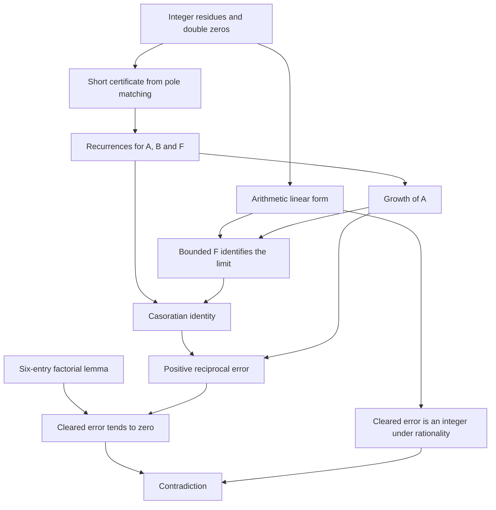

# Discovering the mechanism behind Apéry’s proof

*A living mathematical exposition for the Mathathon team.*

The main result is a complete proof of the irrationality of \(\zeta(3)\) using Zudilin’s first rational function and one short recurrence certificate. The analytic half is reorganized: a very rough estimate identifies the approximation limit, and a discrete determinant then gives positivity and exponential smallness. Ball’s second series and the saddle-point calculation are unnecessary for this route.

This is a simplification assembled from classical Apéry-type ingredients, not a claim of a historically new proof. The explanations of how one might discover the ingredients are mathematical reconstructions. They are not claims about the private reasoning of Apéry, Zudilin, or Beukers. The principal source is [Zudilin’s original paper](https://arxiv.org/abs/math/0202159); [the companion exposition](zudilin-explained.md) follows its seven lemmas individually. All normalizations used here are explicit.

## 1. Design the contradiction before choosing the formula

A rational number cannot be too close to an integer in an arithmetic lattice whose spacing we know. More precisely, suppose

\[
A_n\in\mathbb Z,\qquad D_n^3B_n\in\mathbb Z,
\qquad D_n=\operatorname{lcm}(1,\ldots,n),
\]

with the convention \(D_0=1\), and

\[
0<D_n^3(A_n\alpha-B_n)\longrightarrow0.
\]

Then \(\alpha\) is irrational. Indeed, if \(\alpha=p/q\), the expression
\(qD_n^3(A_n\alpha-B_n)\) is a positive integer tending to zero.

This target has three independent requirements: controlled denominators, nonvanishing, and decay after denominators are cleared. A spectacular decimal approximation may satisfy none of them. The auxiliary function must be designed to serve all three.

For \(\zeta(3)\), summing a cubic pole over positive integers is natural:

\[
\sum_{t=1}^{\infty}\frac1{(t+k)^3}
 =\zeta(3)-H_k^{(3)},
\qquad H_k^{(r)}=\sum_{j=1}^k j^{-r}.
\]

Thus we want cubic poles at nonpositive integers. Rather than construct them directly, we will differentiate a square of a simple-pole function. This gives cubic poles while making their coefficients integral squares. The remaining lower-order poles will cancel for a structural reason.

## 2. Zeros and poles force the auxiliary product

Fix \(n\ge0\). Place simple poles at
\(0,-1,\ldots,-n\), and require zeros at the first \(n\) positive integers. Up to scaling, these conditions force

\[
P_n(t)=\frac{(t-1)\cdots(t-n)}{t(t+1)\cdots(t+n)},
\qquad R_n(t)=P_n(t)^2.
\tag{1}
\]

The numerator degree is at most \(n\), so prescribing \(n\) roots leaves only one scalar parameter. The normalization in (1) is especially useful because all residues are integers:

\[
P_n(t)=\sum_{k=0}^{n}\frac{c_{n,k}}{t+k},
\qquad
c_{n,k}=(-1)^{n-k}\binom nk\binom{n+k}{k}.
\tag{2}
\]

To check (2), multiply by \(t+k\) and substitute \(t=-k\). Both sides then have the same residues, and their difference is a rational function without poles that vanishes at infinity.

Why these particular features? The integral pole lattice controls denominators through differences \(k-\ell\). The positive integer zeros suppress the first summands. Squaring makes these zeros double, so they remain zeros after one differentiation. The function also decays as \(t^{-2}\), which will cancel an unwanted zeta coefficient.

These are simultaneous design decisions, not decorative features of an already-known answer.

## 3. The arithmetic is easiest before simplifying the formula

Squaring (2), write

\[
R_n(t)=\sum_{k=0}^{n}
 \left(\frac{a_{n,k}}{(t+k)^2}+\frac{b_{n,k}}{t+k}\right).
\]

The identity

\[
\frac1{(t+k)(t+\ell)}
 =\frac1{\ell-k}\left(\frac1{t+k}-\frac1{t+\ell}\right)
\]

immediately gives

\[
a_{n,k}=c_{n,k}^2,\qquad
\frac{b_{n,k}}2=c_{n,k}\sum_{\ell\ne k}\frac{c_{n,\ell}}{\ell-k}.
\tag{3}
\]

Consequently

\[
a_{n,k}\in\mathbb Z,\qquad
D_n\frac{b_{n,k}}2\in\mathbb Z.
\tag{4}
\]

Only differences between pole locations occur. An alternative logarithmic-derivative formula introduces harmonic numbers as large as \(H_{n+k}\), making the same denominator fact look mysterious. Formula (3) exposes the cancellation before it needs to be proved.

Because \(R_n(t)=O(t^{-2})\), its coefficient of \(t^{-1}\) at infinity is zero. Hence

\[
\sum_{k=0}^{n}b_{n,k}=0.
\tag{5}
\]

Define

\[
F_n=-\sum_{t=1}^{\infty}R_n'(t).
\tag{6}
\]

Differentiation and summation of the finite partial fractions are legitimate: the resulting series converge absolutely. Equations (3)–(5) yield

\[
F_n=2\bigl(A_n\zeta(3)-B_n\bigr),
\tag{7}
\]

where

\[
A_n=\sum_{k=0}^{n}c_{n,k}^2,
\qquad
B_n=\sum_{k=0}^{n}
 \left(a_{n,k}H_k^{(3)}+\frac{b_{n,k}}2H_k^{(2)}\right).
\tag{8}
\]

The possible \(\zeta(2)\) coefficient is \(\frac12\sum b_{n,k}=0\). Since \(D_n^rH_k^{(r)}\) is integral for \(k\le n\), we have proved

\[
A_n\in\mathbb Z,\qquad D_n^3B_n\in\mathbb Z.
\tag{9}
\]

The initial values are

\[
(A_0,A_1)=(1,5),\qquad(B_0,B_1)=(0,6).
\tag{10}
\]

The arithmetic half of the proof is now complete. We have not assumed irrationality or positivity.

## 4. Discover the recurrence by matching poles

The three adjacent functions \(R_{n-1},R_n,R_{n+1}\) differ by only a few factors. We look for a relation whose right side is a difference in \(t\), because summing such a difference leaves only endpoints:

\[
uR_{n+1}(t)+vR_n(t)+wR_{n-1}(t)
 =q(t+1)R_n(t+1)-q(t)R_n(t).
\tag{11}
\]

Try \(q(t)=at^2+bt+c\). A quadratic is the largest polynomial degree for which \((qR_n)'\) tends to zero at infinity; this fits the differentiated sum in (6). It is a motivated finite search space, not a theorem excluding every other kind of certificate.

The product formula gives

\[
\frac{R_{n+1}}{R_n}=\left(\frac{t-n-1}{t+n+1}\right)^2,
\quad
\frac{R_{n-1}}{R_n}=\left(\frac{t+n}{t-n}\right)^2,
\quad
\frac{R_n(t+1)}{R_n(t)}
 =\frac{t^4}{(t-n)^2(t+n+1)^2}.
\]

After division by \(R_n\), only two possible poles remain: \(t=n\) and \(t=-n-1\). Match the double-pole coefficients and then the simple-pole coefficients. At the first pole this gives

\[
w=\frac{n^2q(n+1)}{4(2n+1)^2},
\qquad
n(2n+1)q'(n+1)+(4n+3)q(n+1)=0.
\]

At the second it gives

\[
u=\frac{(n+1)^2q(-n)}{4(2n+1)^2},
\qquad
(n+1)(2n+1)q'(-n)-(4n+1)q(-n)=0.
\]

The two homogeneous conditions on \(a,b,c\) have rank two: the determinant of their \(a,c\) columns is \(-3(2n+1)^3\). Substitution therefore proves that every solution is a multiple of

\[
q(t)=\lambda\bigl[-2t^2+t+(2n+1)^2\bigr].
\]

Taking \(\lambda=4(2n+1)\) makes \(u=(n+1)^3\), \(w=n^3\). Finally, comparison at infinity gives

\[
v=-4(2n+1)^3-(n+1)^3-n^3
  =-(2n+1)(17n^2+17n+5).
\]

These checks prove the rational identity: its difference has no finite poles and tends to zero at infinity. The familiar recurrence coefficients have been derived from pole positions, multiplicities, and normalization.

Set

\[
\beta_n=(2n+1)(17n^2+17n+5),\qquad
S_n(t)=4(2n+1)\bigl[-2t^2+t+(2n+1)^2\bigr]R_n(t).
\]

Our certificate is

\[
(n+1)^3R_{n+1}-\beta_nR_n+n^3R_{n-1}
 =S_n(t+1)-S_n(t).
\tag{12}
\]

Differentiating and summing proves

\[
(n+1)^3F_{n+1}-\beta_nF_n+n^3F_{n-1}=0.
\tag{13}
\]

The upper endpoint vanishes because \(S_n'=O(t^{-2})\). The lower one vanishes because \(R_n\), and hence \(S_n\), has a double zero at \(t=1\).

A logical point matters here: we cannot yet equate the rational and \(\zeta(3)\) coefficients of (13). That would assume the irrationality we are trying to prove. Instead, take the double-pole coefficient of (12) at each integer pole and sum. If the double-pole coefficients of \(S_n\) are \(d_k\), those of \(S_n(t+1)-S_n(t)\) are \(d_{k-1}-d_k\), whose sum is zero. Thus \(A_n\) satisfies (13) separately. Equation (7) then shows that \(B_n\) does too.

## 5. A rough estimate is enough to identify the limit

For integer \(1\le t\le n\), we have \(R_n'(t)=0\). For integer \(t>n\), each ratio \((t-j)/(t+j)\) lies in \((0,1)\), so

\[
0<R_n(t)\le t^{-2}.
\]

Logarithmic differentiation gives the deliberately crude bound

\[
|R_n'(t)|
\le2R_n(t)\left(\sum_{j=1}^n\frac1{t-j}
                +\sum_{j=0}^n\frac1{t+j}\right)
\le\frac{4n+2}{t^2}.
\]

Every denominator here is a positive integer. Therefore, for \(n\ge1\),

\[
|F_n|\le(4n+2)\sum_{t=n+1}^{\infty}t^{-2}
       \le4+\frac2n.
\tag{14}
\]

This does not prove that \(F_n\) is small. It proves something easier that will be enough for now.

Put \(r_n=A_n/A_{n-1}\). The recurrence gives

\[
r_{n+1}=\frac{\beta_n-n^3/r_n}{(n+1)^3}.
\]

Starting with \(r_1=5\), induction shows \(r_n\ge5\), because

\[
5\beta_n-n^3-25(n+1)^3
 =144n^3+180n^2+60n\ge0.
\]

Hence \(A_n\ge5^n\). Combining this with (7) and (14),

\[
\frac{B_n}{A_n}\longrightarrow\zeta(3).
\tag{15}
\]

The strategy has separated identification from error estimation. We first establish the correct limiting constant using a bounded numerator and a growing denominator. We then let the recurrence determine the error.

## 6. A two-by-two determinant supplies positivity and decay

Define the discrete Wronskian, also called a Casoratian,

\[
W_n=A_nB_{n+1}-A_{n+1}B_n.
\]

Substitution of the recurrence gives

\[
W_n=\frac{n^3}{(n+1)^3}W_{n-1}.
\]

Since \(W_0=6\),

\[
W_n=\frac6{(n+1)^3}.
\tag{16}
\]

Divide by \(A_nA_{n+1}\), sum from \(n\) to infinity, and use (15):

\[
\zeta(3)-\frac{B_n}{A_n}
 =6\sum_{j=n}^{\infty}\frac1{(j+1)^3A_jA_{j+1}}>0.
\tag{17}
\]

This proves nonvanishing and its sign. Moreover \(A_{n+k}\ge5^kA_n\), so

\[
0<A_n\zeta(3)-B_n
 \le\frac6{(n+1)^3A_n}
       \sum_{k=0}^{\infty}5^{-2k-1}
 =\frac5{4(n+1)^3A_n}.
\tag{18}
\]

Growth of one solution has produced reciprocal decay of the complementary solution. This is the conceptual replacement for Ball’s positive series in this presentation. A second-order recurrence has two dimensions of solutions; after the growing component is cancelled, the determinant identity controls what remains.

## 7. Prove only the growth estimate the arithmetic requires

There is no need to calculate a sharp asymptotic. The exact decomposition

\[
\frac{\beta_n}{(n+1)^3}
 =34-\frac{51}{n+1}+\frac{27n+22}{(n+1)^3}
\]

and \(r_n\ge5\) give

\[
r_{n+1}>\frac{169}{5}-\frac{51}{n+1}.
\]

For \(n\ge1019\), this is at least \(Q=135/4\). Therefore some fixed \(C>0\) satisfies

\[
A_n\ge C Q^n\qquad(n\ge1019).
\tag{19}
\]

The cutoff is intentionally crude. Irrationality needs an eventual exponential advantage, not an efficient numerical approximation algorithm.

We next prove the matching arithmetic estimate rather than silently invoking the prime number theorem.

**Elementary denominator lemma.**

\[
\log D_n\le cn+O(\log^2(n+1)),
\qquad c=\frac12\log2+\frac34\log3.
\tag{20}
\]

For real \(x\ge1\), put \(\psi(x)=\log D_{\lfloor x\rfloor}\), and consider

\[
\mathcal L(x)=\log(\lfloor x\rfloor!)
 -\log(\lfloor x/2\rfloor!)
 -2\log(\lfloor x/3\rfloor!)
 +\log(\lfloor x/6\rfloor!).
\]

Counting multiples of each prime power in a factorial gives

\[
\mathcal L(x)=\sum_{p\text{ prime},\ a\ge1}
 h(x/p^a)\log p,
\quad
h(y)=\lfloor y\rfloor-\lfloor y/2\rfloor
             -2\lfloor y/3\rfloor+\lfloor y/6\rfloor.
\]

The function \(h\) has period six. Its values on the intervals \([j,j+1)\) are

| \(j\) | 0 | 1 | 2 | 3 | 4 | 5 |
|---|---:|---:|---:|---:|---:|---:|
| \(h\) | 0 | 1 | 1 | 0 | 0 | 1 |

Thus \(h\ge0\) and \(h=1\) on \([1,3)\). Every prime power in \((x/3,x]\) contributes to \(\mathcal L(x)\), proving

\[
\psi(x)-\psi(x/3)\le\mathcal L(x).
\]

The integral comparison for the increasing function \(\log t\) gives
\(\log(m!)=m\log m-m+O(\log(m+1))\). Applying it at the four fixed scales,

\[
\mathcal L(x)=\left(\frac13\log2+\frac12\log3\right)x
              +O(\log(x+1)).
\]

The terms in \(x\log x\) and \(x\) cancel because
\(1-1/2-2/3+1/6=0\). Iterating the inequality for \(\psi\) gives a geometric sum with factor \(3/2\), and at most \(O(\log x)\) error terms of size \(O(\log x)\). This proves (20).

The design of this lemma mirrors the rest of the proof. Choose a balanced factorial ratio so large terms cancel; keep its prime valuations nonnegative; make it capture a fixed interval of prime powers. A six-entry table certifies all of this.

## 8. The contradiction

The necessary strict comparison contains no uncertain decimal calculation:

\[
\frac{Q^4}{e^{12c}}=\frac{16875}{16384}>1.
\tag{21}
\]

Hence \(e^{3c}<Q\). Equations (18)–(20) imply

\[
0<D_n^3(A_n\zeta(3)-B_n)
 \le\frac{5D_n^3}{4(n+1)^3A_n}\longrightarrow0.
\]

If \(\zeta(3)=p/q\), multiplying by \(q\) produces a positive integer tending to zero, impossible. Therefore

\[
\boxed{\zeta(3)\text{ is irrational}.}
\]

No saddle-point theorem, prime number theorem, or special-function identity was used in this proof. Its analytic inputs were convergence of elementary series and the integral comparison for \(\log(m!)\). Its central new organizational choice was to identify the limit cheaply, then use the recurrence to obtain the strong error bound.

## 9. The integral supplement reveals the same object

There is an unexpected reason the numerator and denominator in (1) fit together. Define the shifted Legendre polynomial

\[
\mathcal P_n(x)=\frac1{n!}\frac{d^n}{dx^n}[x^n(1-x)^n].
\]

Its Mellin transform is

\[
\int_0^1x^{t-1}\mathcal P_n(x)\,dx=(-1)^nP_n(t).
\tag{22}
\]

For \(t>n\), this follows by \(n\) integrations by parts and the beta integral. Both sides are rational functions of \(t\), so the identity holds wherever defined, in particular for \(t>0\). Orthogonality gives another discovery explanation: \(\int_0^1x^{j-1}\mathcal P_n(x)\,dx=0\) for \(j=1,\ldots,n\). Those are precisely the prescribed numerator zeros.

Squaring (22), differentiating in \(t\), and summing gives

\[
F_n=\int_0^1\!\int_0^1
 \mathcal P_n(x)\mathcal P_n(y)
 \frac{-\log(xy)}{1-xy}\,dx\,dy.
\tag{23}
\]

Boundedness of the polynomials and integrability of the logarithmic kernel justify the exchanges. The residues of the Mellin transform are the polynomial coefficients; squaring them produces the same \(A_n\) in either language.

The integrand in (23) changes sign. Beukers turns it into a positive one:

\[
F_n=\int_{[0,1]^3}
 \frac{[x(1-x)y(1-y)z(1-z)]^n}
      {(1-z+xyz)^{n+1}}\,dx\,dy\,dz.
\tag{24}
\]

The useful substitution is designed, not guessed after the fact. First express the logarithmic kernel as \(\int_0^1(1-z+xyz)^{-1}\,dz\), then integrate by parts in \(x\). Before integrating by parts in \(y\), make

\[
w=\frac{1-z}{1-z+xyz}.
\]

This removes the unwanted \(y^n\) factor from the kernel. A second integration by parts now produces (24). The explicit Jacobian, endpoint conditions, and absolute-integrability justification are in [the integral proof](beukers-explained.md).

Even the exponential bound can be discovered through squares. Put \(t=\sqrt{xy}\) and \(a=\sqrt2-1\). Then

\[
\frac{x(1-x)y(1-y)z(1-z)}{1-z+xyz}
 \le\left(\frac{t(1-t)}{1+t}\right)^2\le a^4.
\]

The first inequality uses \(x+y\ge2\sqrt{xy}\) and
\([1-(1+t)z]^2\ge0\). The second is exactly

\[
a^2(1+t)-t(1-t)=(t-a)^2\ge0.
\]

Thus \(0<F_n\le2\zeta(3)(\sqrt2-1)^{4n}\). This supplies positivity and decay directly, bypassing the recurrence argument. Indeed \(Q=135/4<17+12\sqrt2=(\sqrt2-1)^{-4}\), as squaring \(67<48\sqrt2\) verifies. Together with (21), the elementary denominator estimate is therefore sufficient here too. It is a second complete route once combined with the arithmetic already proved.

The two routes explain different things. The recurrence route explains why growth and decay are reciprocal. The integral route makes positivity visible and gives the sharp exponential constant. Their equality through the Mellin transform explains why they repeatedly produce the same coefficients and constants.

## 10. Test the mechanism by changing the derivative

A good explanation should predict failure as well as success. For \(m\ge1\), consider

\[
L_{n,m}=-\frac1{(2m)!}\sum_{t=1}^{\infty}R_n^{(2m-1)}(t).
\]

Partial fractions still give a single odd zeta value:

\[
L_{n,m}=A_n\zeta(2m+1)-B_{n,m},
\qquad 2mD_n^{2m+1}B_{n,m}\in\mathbb Z.
\]

So isolating \(\zeta(5)\) is not itself the obstacle. Differentiate the same certificate more times, however, and the lower endpoint survives:

\[
(n+1)^3L_{n+1,m}-\beta_nL_{n,m}+n^3L_{n-1,m}
 =\frac{S_n^{(2m-1)}(1)}{(2m)!}.
\tag{25}
\]

For \(m=1\), the double zero at \(t=1\) kills this term. For \(m=2\), direct expansion gives

\[
\frac{S_n'''(1)}{24}
 =-\frac{(2n+1)\{3+8n(n+1)[H_{n-1}+H_{n+1}]\}}
          {n^2(n+1)^2}.
\tag{26}
\]

It is nonzero and decreases only polynomially. If \(L_{n,2}\) were exponentially small, the left side of (25) would be exponentially small up to a cubic factor; (26) makes that impossible. The [full obstruction proof](forced-recurrence-obstruction.md) extends this diagnosis to every fixed \(m\ge2\).

This is a substantive mathematical consequence of the motivation: double zeros and one derivative are a matched pair. Higher derivatives break the match. More zeros or a different summation range may repair it, but the arithmetic must then be checked again.

> **Verified repair, unresolved irrationality step.** Omitting \(t=1,\ldots,n\) in the third-derivative sum restores exponential decay. The [truncation investigation](truncated-derivative.md), independently reviewed, proves an eventual asymptotic with rate \(16^{-n}\). But the correction introduces denominator primes above \(n\), and the original \(D_n^5\) arithmetic no longer applies. A new decay estimate alone therefore does not finish a proof of \(\zeta(5)\)’s irrationality.

> **Open design task.** Seek an auxiliary construction that preserves all three requirements together: a single desired zeta coefficient, controlled denominators, and sufficiently small nonzero values. The [positive moment construction](odd-moment-generalization.md) and [determinant criterion](determinant-capacity-recipe.md) change the approximation object from a linear form to a polynomial. Their analytic positivity is proved; adequate normalization remains a separate requirement.

These are precise research questions. They should not be described as evidence that an unverified generalization succeeds.

## 11. What to retain for a presentation

The proof can be told as a sequence of necessities. Start with the integer contradiction. Choose poles where sums become zeta values. Choose zeros where the sum should disappear. Square to combine integer coefficients with surviving zeros. Differentiate once to reach cubic poles. Discover a recurrence by matching the few poles in adjacent ratios. Identify the limit with a deliberately rough bound. Use the Casoratian to convert growth into positive reciprocal error. Finally compare that growth with a proved denominator estimate.

The strongest connections are exact, not analogies: polynomial orthogonality becomes zeros of a Mellin transform; its coefficients become residues; a discrete Wronskian measures approximation error; and a factorial valuation table pays the arithmetic cost of the approximation. The higher-derivative obstruction shows which part of this architecture is special to the successful construction.

The [claim ledger](../CLAIM_LEDGER.md) records proof and review status. The [source provenance](../sources/odd-zeta-provenance.md) also matters for current higher-zeta claims: this project retrieved Fauzan’s September 2026 preprint and inspected formalization reports, but has not locally built Lean or independently audited that entire preprint. No historical novelty is asserted for the reorganizations or derived lemmas here.
