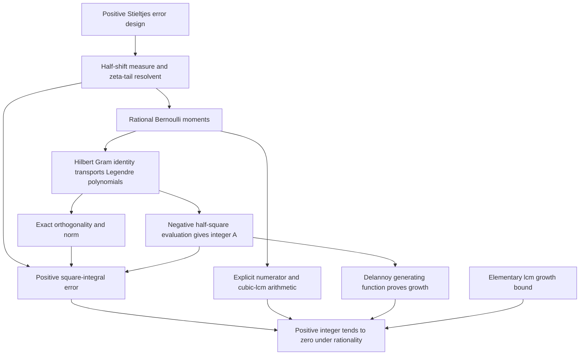

# A positive resolvent and a Legendre isometry prove Apéry's irrationality

Status: complete proof, accepted in the
[independent full-proof audit](resolvent-legendre-pade-independent-review.md),
with the analytic, algebraic and arithmetic steps exposed below. The underlying Wilson–Padé
proof of irrationality is classical: Prévost (1996), §§3.2–3.3,
pp.229–231. This note reconstructs that route using a positive real
resolvent, an elementary Legendre isometry, direct denominator bounds and
an elementary exponential estimate. No historical novelty is claimed.

No Apéry recurrence, general Wilson orthogonality theorem, triple integral,
Stirling asymptotic, or prime number theorem is needed in the argument below.
The analytic input now has a fully real proof using finite Chebyshev
polynomials and elementary integrals. The earlier Fourier contour
calculation is retained below only as an optional verification.
The remaining ingredients are polynomial identities and elementary
factorial estimates.

## Design route: build the error before choosing the polynomials

This is a reconstruction of why the ingredients fit together, not testimony
about Prévost's or Apéry's historical thought process. Every identity used
in this outline is proved in the numbered sections below.

**Start with the desired sign.** We want a rational approximation whose error
is visibly nonzero and small. A positive measure suggests its Stieltjes
transform \(\mathscr M(a)=\int(t+a^2)^{-1}\,d\nu(t)\).
If a degree-\(n\) polynomial \(\Phi\) is orthogonal to lower degrees and
\(A=\Phi(-a^2)\ne0\), polynomial division and orthogonality give
\[
 \mathscr M(a)-
 \frac1A\nu\!\left(\frac{A-\Phi(t)}{t+a^2}\right)
 =\frac1{A^2}\int\frac{\Phi(t)^2}{t+a^2}\,d\nu(t)>0.
\]
The quotient in the approximation is a polynomial. Rational moments can
therefore make the approximation rational, while the square integral supplies
positivity. The size of \(A\) and the norm of \(\Phi\) now become the quantities
to design.

**Choose a measure that reaches both the zeta tail and rational moments.**
The cubic tail has a Laplace integral with factor
\(u^2e^{-(a+1/2)u}/(1-e^{-u})\). The Fourier transform of
\(\operatorname{sech}^2(\pi y)\) supplies the matching
\(u/\sinh(u/2)\); differentiating its density gives the extra factor needed
for the cube. This leads to the positive probability measure in §1.
Its transform contains
\[
 \frac{u}{2\sinh(u/2)}
 =\sum_{j\ge0}B_{2j}(1/2)\frac{u^{2j}}{(2j)!},
\]
so the same half-shift that places the zeta tail at \(a+1/2\) gives rational
Bernoulli moments. Choosing \(a=n+1/2\) later will make that tail
\(\zeta(3)-H_n^{(3)}\).

**Transport a polynomial family we already understand.** The rising
half-square products
\[
 Q_k(t)=\frac{\prod_{r=0}^{k-1}(t+(r+1/2)^2)}{(k!)^2}
\]
have the exact Gram matrix \(\nu(Q_jQ_k)=1/(j+k+1)\).
This is the Gram matrix of the monomials \(u^k\) on \([0,1]\).
The polynomial map \(u^k\mapsto Q_k\) therefore transports shifted Legendre
orthogonality and its norm without changing the inner product. A short
finite-difference identity proves the Gram equality in §2. This is the
structural coincidence that makes the familiar Legendre coefficients become
the classical all-half Wilson polynomial \(\Phi_n\).

**Evaluate where both halves of the coefficient become the same integer.**
At the negative half-square \(-(n+1/2)^2\),
\[
 Q_k(-(n+1/2)^2)=(-1)^k
 \binom nk\binom{n+k}k.
\]
The Legendre coefficient already contains the same signed binomial product.
Their product is a square, giving
\[
 A_n=\Phi_n(-(n+1/2)^2)
 =\sum_{k=0}^n\binom nk^2\binom{n+k}k^2.
\]
Thus the special evaluation simultaneously gives an integer denominator,
a positive large value, and the correct zeta tail. The exact norm
\(1/(2n+1)\) turns the general square-integral error into (14).

**Pay the arithmetic cost and prove enough growth.** Rational moments alone
do not control their denominators. The divided-product formula in §4 exposes
the numerator as finite binomial and harmonic sums; a prime-valuation lemma
proves \(d_n^3b_n\in\mathbb Z\), including the required factor of two.
For growth, the unsquared sum \(\sum_k\binom nk\binom{n+k}k\) has the central
Delannoy generating function \((1-6z+z^2)^{-1/2}\).
Its positive coefficients and Cauchy–Schwarz give the sufficient lower bound
for \(A_n\). The elementary lcm estimate then closes the integer contradiction.

The proof answers a different structural question from the official recurrence
problem: it explains why this positive approximation and squared binomial
denominator arise. To derive the recurrence's coefficients, follow the
[two mixed-product telescopes](apery-mixed-numerator-balance.md), with their
[independent audit](apery-mixed-numerator-independent-review.md).
They use the same quadratic-grid coefficients and prove the diagonal closure
that gives \(17=6\cdot3-1\) and \(5=6\cdot1-1\), including the source at zero.

## 1. A probability measure whose resolvent is a zeta tail

On \(t>0\), let
\[
 d\nu(t)=\pi^2\operatorname{sech}^2(\pi\sqrt t)
                         \tanh(\pi\sqrt t)\,dt .
 \tag{1}
\]
Writing \(t=y^2\) gives
\[
 d\nu(y^2)=2\pi^2y\operatorname{sech}^2(\pi y)\tanh(\pi y)\,dy
          =-\pi y\,\frac d{dy}\operatorname{sech}^2(\pi y)\,dy .
\]
Integration by parts proves total mass one. Every polynomial moment
exists, because the density decays exponentially in \(y\).

**Resolvent identity.** For every \(a>0\),
\[
 \boxed{\int_0^\infty\frac{d\nu(t)}{t+a^2}
              =2\sum_{\ell=0}^\infty(a+1/2+\ell)^{-3}
              =2\zeta(3,a+1/2).}                  \tag{2}
\]

**Fully real derivation.** The
[detailed elementary supplement](half-shift-elementary-resolvent-proof.md),
[independently audited](half-shift-elementary-independent-review.md),
proves the partial fractions
\[
 \tanh(\pi y)=\frac2\pi\sum_{j\ge0}\frac{y}{y^2+(j+1/2)^2}.
\]
Its proof starts with the finite Chebyshev product
\[
 \prod_{k=1}^N\left[\sinh^2u+
        \sin^2((k-1/2)\pi/N)\right]
       =2^{2-2N}\cosh^2(Nu),
\]
then logarithmically differentiates, puts \(u=x/N\), pairs the
equal sine terms, and passes to the limit using a uniform
reciprocal-square majorant.
Writing \(h_a(y)=y/(a^2+y^2)\), integration by parts gives
\[
 \int\frac{d\nu(t)}{t+a^2}
 =\frac2\pi\sum_{j\ge0}\int_0^\infty h_a'(y)h_{j+1/2}'(y)\,dy.
\]
The interchange is absolutely justified by
\(\int|h_a'h_b'|\le1/(ab^2)\).
The elementary kernel integral
\[
 \int_0^\infty\frac{a}{a^2+y^2}\frac{b}{b^2+y^2}\,dy
       =\frac{\pi}{2(a+b)}
\]
gives \(\int h_a'h_b'=\pi/(a+b)^3\) by differentiating once
in each positive parameter. This proves (2) by real calculus.
The supplement gives the endpoint, equal-parameter, and convergence
details; no Fourier theorem is used in this route.

**Optional independent Fourier verification.**
The Fourier cosine transform
\[
 H(u)=\int_0^\infty\operatorname{sech}^2(\pi y)\cos(uy)\,dy
       =\frac{u}{2\pi\sinh(u/2)}
 \tag{3}
\]
follows by integrating \(e^{iuz}/\cosh^2(\pi z)\), \(u>0\), around a
rectangle of height \(i\). Its double pole at \(i/2\) has residue
\(-iu e^{-u/2}/\pi^2\); the top edge is \(e^{-u}\) times the bottom
edge with opposite orientation. The vertical edges vanish exponentially.
This gives the full-line transform \(u/(\pi\sinh(u/2))\), twice (3).
Continuity supplies \(u=0\).

Integration by parts now gives
\[
 \int\cos(u\sqrt t)\,d\nu(t)=\pi(H(u)+uH'(u)).
\]
Using \(1/(a^2+y^2)=a^{-1}\int_0^\infty e^{-au}\cos(uy)\,du\)
is legitimate by absolute Fubini: the absolute double integral is at
most \(a^{-2}\nu([0,\infty))\). An integration by parts in \(u\) gives
\[
 \int\frac{d\nu(t)}{t+a^2}
 =\frac\pi a\int_0^\infty e^{-au}(uH(u))'\,du
 =\pi\int_0^\infty e^{-au}uH(u)\,du
 =\int_0^\infty\frac{u^2e^{-(a+1/2)u}}{1-e^{-u}}\,du.
\]
The boundary terms vanish at zero and infinity. Expanding the positive
geometric series and using Tonelli proves (2).

## 2. A polynomial isometry explains the orthogonal polynomials

Let \(\mathcal B(x^j)=B_j\), with \(B_1=-1/2\), and put
\(\mathcal L(f)=\mathcal B(f')\).
The real-series moment calculation in the
[elementary supplement, §3](half-shift-elementary-resolvent-proof.md)
gives
\[
 \nu(t^j)=(-1)^j(2j+1)B_{2j}(1/2).
 \tag{4}
\]
For clarity, that calculation first integrates the density by parts,
then integrates the elementary exponential series for \(\operatorname{sech}^2u\).
The required even-zeta values are derived within the same supplement
by comparing coefficients of the proved tanh partial fractions with
the defining Bernoulli generating series. They are not assumed.
Alternatively, the optional Fourier calculation proves (4) by expanding
\(u/(2\sinh(u/2))=\sum B_{2j}(1/2)u^{2j}/(2j)!\).
Hence for every polynomial \(g\),
\[
 \boxed{\nu(g(t))=
 \mathcal L_x[(x+1/2)g(-(x+1/2)^2)].}              \tag{5}
\]
The Bernoulli generating function also proves
\[
 \mathcal L(f(x+1)-f(x))=f''(0),\qquad
 \mathcal L(f(-x-1))=-\mathcal L(f(x)).
 \tag{6}
\]

Define
\[
 \phi_k(x)=\binom xk\binom{x+k}k,\qquad
 Q_k(t)=\frac1{(k!)^2}\prod_{r=0}^{k-1}(t+(r+1/2)^2).
\]
Empty products are one. These satisfy
\(Q_k(-(x+1/2)^2)=(-1)^k\phi_k(x)\).
Their Gram matrix is particularly simple:
\[
 \boxed{\nu(Q_jQ_k)=\frac1{j+k+1}
                      =\int_0^1u^{j+k}\,du.}      \tag{7}
\]

Here is a direct proof, avoiding Wilson orthogonality.
Set
\[
 E_{jk}(x)=x^2\prod_{r=1}^j(x^2-r^2)
                   \prod_{r=1}^k(x^2-r^2).
\]
Root multiplicities, the symmetry about \(x=-1/2\), and the leading
coefficient give the polynomial identity
\[
 E_{jk}(x+1)-E_{jk}(x)
  =(j+k+1)(j!k!)^2(2x+1)\phi_j(x)\phi_k(x).
 \tag{8}
\]
For explicit root counting, each integer root of \(\phi_j\phi_k\)
is a common root of \(E_{jk}(x)\) and \(E_{jk}(x+1)\), with at
least the required multiplicity. The factor \(x^2\) supplies the
needed endpoint multiplicities at \(0,-1\). Evenness of \(E_{jk}\)
supplies the extra root \(-1/2\). These exhaust degree \(2j+2k+1\).
The leading coefficient of its difference is \(2(j+k+1)\).
Thus (8) holds also when one or both indices are zero.
Applying (6) and
\(E_{jk}''(0)=2(-1)^{j+k}(j!k!)^2\), then (5), proves (7).

Consequently the linear map
\[
 \mathcal T:\mathbb R[u]\longrightarrow\mathbb R[t],
 \qquad \mathcal T(u^k)=Q_k(t),
\]
is degree preserving and satisfies
\[
 \nu((\mathcal Tf)(\mathcal Tg))=\int_0^1f(u)g(u)\,du.
 \tag{9}
\]
It is an isometry of polynomial inner-product spaces, not an assertion
that \(\mathcal T\) preserves products.

The shifted Legendre polynomial
\[
 L_n(u)=\frac1{n!}\frac{d^n}{du^n}[u^n(1-u)^n]
       =\sum_{k=0}^n(-1)^k C_{n,k}u^k,\qquad
 C_{n,k}=\binom nk\binom{n+k}k
\]
is orthogonal to all lower-degree polynomials and has squared norm
\(1/(2n+1)\). Both statements follow by \(n\) integrations by parts
and the beta integral \(\int_0^1u^n(1-u)^n\,du=(n!)^2/(2n+1)!\).
Therefore
\[
 \Phi_n(t)=\mathcal TL_n(t)
     =\sum_{k=0}^n(-1)^k C_{n,k}Q_k(t)
\]
has the exact properties
\[
 \nu(\Phi_n p)=0\quad(\deg p<n),\qquad
 \boxed{\nu(\Phi_n^2)=\frac1{2n+1}.}               \tag{10}
\]

At \(a=n+1/2\), \(Q_k(-a^2)=(-1)^kC_{n,k}\), so
\[
 \boxed{\Phi_n(-(n+1/2)^2)=
       A_n:=\sum_{k=0}^n C_{n,k}^2\in\mathbb Z_{>0}.} \tag{11}
\]
This gives a direct reason for the squared binomial sum.

## 3. The positive Padé error

Fix \(n\ge0\), \(a=n+1/2\), and define
\[
 N_n=\nu\!\left(\frac{A_n-\Phi_n(t)}{t+a^2}\right),\qquad
 b_n=A_nH_n^{(3)}+\frac{N_n}2.
 \tag{12}
\]
The quotient is a polynomial, so \(N_n,b_n\in\mathbb Q\) by (4).
Orthogonality (10), applied to
\((\Phi_n(t)-A_n)/(t+a^2)\), gives
\[
 \int\frac{\Phi_n(t)^2}{t+a^2}\,d\nu(t)
       =A_n\int\frac{\Phi_n(t)}{t+a^2}\,d\nu(t).
\]
Combining this with (2) and (12) proves the exact error identity
\[
 \boxed{\zeta(3)-\frac{b_n}{A_n}
    =\frac1{2A_n^2}\int_0^\infty
                   \frac{\Phi_n(t)^2}{t+(n+1/2)^2}\,d\nu(t)>0.} \tag{13}
\]
The integral is strictly positive because its density is positive and
\(\Phi_n\) is a nonzero polynomial. Its norm bound gives
\[
 \boxed{0<A_n\zeta(3)-b_n
            \le\frac{2}{(2n+1)^3A_n}.}            \tag{14}
\]
This is the ordinary positive Markov/Padé error mechanism, evaluated
at a point that moves with \(n\). Its proof above needs no approximation
theorem and no recurrence.

## 4. Exact numerator and direct arithmetic

Let \(d_n=\operatorname{lcm}(1,\ldots,n)\), \(d_0=1\).
The numerator has the explicit formula
\[
 \boxed{N_n=\sum_{k=1}^n C_{n,k}^2
           \sum_{m=1}^k\frac{(-1)^{m-1}}{m^3C_{n,m}}.} \tag{15}
\]
To verify it, put \(D_k(t)=(k!)^2Q_k(t)\), \(s=-a^2\), and use
\[
 \frac{D_k(t)-D_k(s)}{t-s}
  =\sum_{j=0}^{k-1}D_j(t)
        \prod_{\ell=j+1}^{k-1}(s+(\ell+1/2)^2).
\]
Equation (7) with \(k=0\) gives
\(\nu(D_j)=(j!)^2/(j+1)\).
At \(a=n+1/2\) the tail product is
\[
 (-1)^{k-j-1}
 \frac{(n-j-1)!}{(n-k)!}\frac{(n+k)!}{(n+j+1)!}.
\]
Insert these values and the coefficient
\((-1)^k(n+k)!/[(n-k)!(k!)^4]\) of \(D_k\) in \(\Phi_n\).
Setting \(m=j+1\) simplifies precisely to (15).

**Divisibility lemma.** If \(1\le m\le k\le n\), then
\[
 \boxed{d_n^3\,\frac{C_{n,k}^2}{m^3C_{n,m}}\in2\mathbb Z.} \tag{16}
\]
Fix a prime \(p\), put \(\nu_p=\lfloor\log_p n\rfloor\) and
\(e=v_p(m)\), and abbreviate \(C_{n,s}\) by \(C_s\).
Legendre's factorial valuation formula writes
\[
 v_p(C_s)=\sum_{\ell\ge1}
 \left(\left\lfloor\frac{n+s}{p^\ell}\right\rfloor
 -\left\lfloor\frac{n-s}{p^\ell}\right\rfloor
 -2\left\lfloor\frac{s}{p^\ell}\right\rfloor\right).
\]
Each summand is \(0,1,\) or \(2\).
For \(s=m,\ell\le e\) it is zero.
There are at most \(\nu_p-e\) levels \(e<\ell\le\nu_p\).
For \(\ell>\nu_p\), since \(p^\ell>n\), the summand is simply
\(\lfloor(n+s)/p^\ell\rfloor\), nondecreasing in \(s\).
Consequently
\[
 v_p(C_m)\le v_p(C_k)+2(\nu_p-e),
\]
and the valuation of the left side of (16) is at least
\[
 v_p(C_k)+\nu_p-e\ge0.                            \tag{17}
\]
For \(p=2\) this is at least one. If \(e<\nu_2\), this is immediate.
Otherwise \(m=2^{\nu_2}\), and \(k\ge m,n\ge m\) imply
\(n+k\ge2^{\nu_2+1}>n\). The level \(\ell=\nu_2+1\)
then contributes one to \(v_2(C_k)\).
This also handles \(n=1\). Thus (16) is proved.

Summing (16) in (15), and using \(d_n^3H_n^{(3)}\in\mathbb Z\), proves
\[
 \boxed{d_n^3N_n\in2\mathbb Z,\qquad
        d_n^3b_n\in\mathbb Z.}                    \tag{18}
\]
No Bernoulli-denominator estimate is hidden in this step.

## 5. A lower bound from a positive generating function

Put \(S_n=\sum_{k=0}^n C_{n,k}\).
Since \(C_{n,k}=\binom{2k}{k}\binom{n+k}{2k}\), summing first over \(n\)
gives the formal series identity
\[
 \sum_{n\ge0}S_nz^n=\frac1{\sqrt{1-6z+z^2}}
 =\frac1{\sqrt{1-\alpha z}}\frac1{\sqrt{1-\alpha^{-1}z}},
 \quad\alpha=3+2\sqrt2.
\]
All coefficients in the last two factors are positive. Hence
\[
 S_n\ge\alpha^n\frac{\binom{2n}{n}}{4^n}
       \ge\frac{\alpha^n}{2n+1}.
\]
The last inequality follows because the central binomial coefficient
is the largest of the \(2n+1\) coefficients summing to \(4^n\).
Cauchy–Schwarz therefore gives
\[
 A_n\ge\frac{S_n^2}{n+1}
       \ge\frac{\lambda^n}{(n+1)(2n+1)^2},
 \qquad\lambda=\alpha^2=17+12\sqrt2.
\]
Together with (14),
\[
 \boxed{0<A_n\zeta(3)-b_n
       \le\frac{2(n+1)}{2n+1}\lambda^{-n}<2\lambda^{-n}
       \quad(n\ge1).}                            \tag{19}
\]

## 6. The elementary denominator-growth estimate and contradiction

For reference, the [period-six lcm proof](denominator-design.md) gives
\[
 \log d_n\le cn+O(\log^2(n+2)),\qquad
 c=\tfrac12\log2+\tfrac34\log3,\qquad 3c<\log\lambda.
\]
Its short derivation is as follows. Set
\[
 T(x)=\log\lfloor x\rfloor!-\log\lfloor x/2\rfloor!
              -2\log\lfloor x/3\rfloor!+\log\lfloor x/6\rfloor!.
\]
Prime-power counting gives \(T(x)=\sum_{p,\ell}h(x/p^\ell)\log p\),
where \(h(y)=\lfloor y\rfloor-\lfloor y/2\rfloor
-2\lfloor y/3\rfloor+\lfloor y/6\rfloor\) is periodic of period six
with values \(0,1,1,0,0,1\). Thus
\(\log d_{\lfloor x\rfloor}-\log d_{\lfloor x/3\rfloor}\le T(x)\).
The integral comparison
\(\log r!=r\log r-r+O(\log(r+2))\) gives
\(T(x)=(\log2/3+\log3/2)x+O(\log(x+2))\).
Iteration over \(x,x/3,x/9,\ldots\) proves the bound.
The strict comparison is exact:
\(\lambda>169/5\), since \(\sqrt2>7/5\), and
\[
 e^{12c}=64\cdot3^9=1259712
         <169^4/5^4=815730721/625.
\]

If \(\zeta(3)=r/q\) were rational, (18) would make
\[
 qd_n^3(A_n\zeta(3)-b_n)
\]
a positive integer for every \(n\). Equations (19) and the lcm estimate
make it tend to zero. This is impossible. Therefore \(\zeta(3)\) is irrational.

## 7. Exact comparison with Prévost and the associated polynomial

Our \(\Phi_n\) is the classical Wilson polynomial
\(W_n(t;1/2,1/2,1/2,1/2)/(n!)^3\), but this identification was not
used to import its orthogonality or norm.
Let
\(\Pi_n(x)=\Phi_n(-(x+1/2)^2)=\sum_k\phi_k(n)\phi_k(x)\).
For an arbitrary nonnegative integer \(m\), define
\[
 \Theta_n(m)=\mathcal L_x
           \left(\frac{\Pi_n(x)-\Pi_n(m)}{x-m}\right).
\]
The real associated numerator equals this exactly:
\[
 \nu\left(\frac{\Pi_n(m)-\Phi_n(t)}{t+(m+1/2)^2}\right)
                    =\Theta_n(m).                \tag{20}
\]
Indeed (5) changes the left side into
\[
 \tfrac12\mathcal L_x\left[
  \frac{\Pi_n(x)-\Pi_n(m)}{x-m}
 +\frac{\Pi_n(x)-\Pi_n(m)}{x+m+1}\right].
\]
The two functional values coincide by reflection (6) and
\(\Pi_n(-x-1)=\Pi_n(x)\). This proves (20) for all indices,
not merely through comparison of initial values.

Prévost uses the subscript \(2n\) for our \(\Pi_n,\Theta_n\) and
calls our \(A_n,b_n\) respectively \(b_n,a_n\).
On printed p.230, equations (57)–(58) identify the same denominator
and numerator. Printed pp.230–231 then use the positive Wilson norm
to bound the Padé error and finish irrationality.
Those pages were visually inspected in the scanned primary PDF,
not reconstructed from unreliable OCR.

This note gives elementary proofs of the needed norm via (7)–(10),
the exact real error via (2), the denominator parity via (16), and a
lower bound sufficient for irrationality via (19). It replaces the
source's cited growth asymptotic and prime-number estimate by explicit
elementary bounds. It does not claim a new underlying Padé proof.

Primary reference: M. Prévost, *A new proof of the irrationality of
ζ(2) and ζ(3) using Padé approximants*, Journal of Computational and
Applied Mathematics 67 (1996), 219–235,
DOI 10.1016/0377-0427(95)00019-4.
[Primary scanned PDF](https://www.math.ru.nl/~zudilin/zw/Prevost96.pdf).
The source and SHA-256 provenance are recorded in
[the existing source manifest](../sources/rank-one-primary-context-provenance.json).
The re-rendered pages used here are stored under
codex/sources/prevost-resolvent-review-12.png and -13.png.

## Verification

[Exact and numerical checker](../computations/check_resolvent_legendre_pade.py)
passes 49 polynomial difference certificates and Hilbert-Gram identities,
11 exact associated-numerator comparisons, the Legendre norms and
orthogonality, 11,480 even-integer divisibility cases, and the exact
integer exponential comparison. Five direct Hurwitz-resolvent quadratures
and six positive Padé-error quadratures also pass at high precision.
These calculations check normalization and finite cases; the all-index
arguments and contour justifications are the proofs above.
