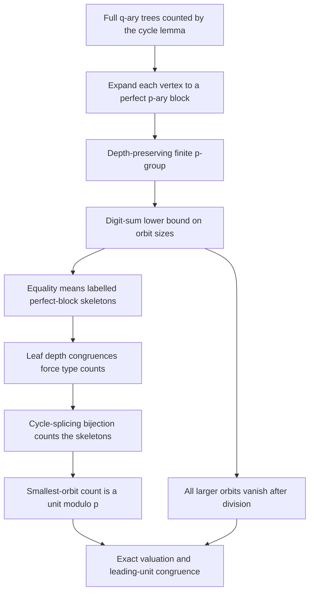

# Exact Fuss–Catalan valuations from tree symmetries

*A combinatorial proof for the prime-power case in Mathathon problem #137.*

The [exact official statement](../sources/problem137-official.md) asks whether tree symmetries can explain the **exact** prime-adic valuation of Fuss–Catalan numbers when the arity is a prime power. It singles out the missing step: a group action can prove a divisibility bound without proving that the next prime power fails to divide.

The proof below addresses that step by classifying and counting the smallest orbits. It uses an explicitly defined finite group, elementary digit arithmetic, and an invertible cycle-splicing construction. Factorials occur as counts of finite bijections; no formula for the valuation of a factorial, Kummer’s theorem, multivariable Lagrange inversion, or matrix-tree theorem is used.

This is a developed and independently checked proof, not a claim of historical novelty. The binary orbit argument is due to Deutsch and Sagan. Konvalinka’s primary paper already gives the general exact formula arithmetically and a tree-action divisibility theorem. The source comparison at the end states precisely how this construction addresses the proof gap identified in the problem.

## 1. The theorem and the strategy

Let \(p\) be prime, \(e\ge1\), \(q=p^e\), and \(n\ge0\). Set

\[
T_q(n)=\frac1{(q-1)n+1}\binom{qn}{n},\qquad
L=(q-1)n+1=\sum_{j\ge0}d_jp^j,\quad 0\le d_j<p.
\]

Write \(s=\sum_jd_j=s_p(L)\) and

\[
D=\frac{s-1}{p-1}.
\]

This is a nonnegative integer: digit sums preserve residues modulo \(p-1\), and \(L\equiv1\pmod{p-1}\).

**Theorem.**

\[
\boxed{\quad v_p(T_q(n))=D.\quad}
\tag{1}
\]

More precisely, in \(\mathbb F_p\),

\[
\boxed{\quad p^{-D}T_q(n)
 \equiv\frac{(-1)^D}{\prod_jd_j!}\ne0.\quad}
\tag{2}
\]

Every \(d_j!\) is nonzero modulo \(p\), so the displayed division is legitimate.

The strategy is to partition the trees into orbits of a finite \(p\)-group. We will prove that every orbit size is divisible by \(p^D\). Then we count the orbits of size **exactly** \(p^D\), showing their number is nonzero modulo \(p\). All larger orbits disappear after dividing the total by \(p^D\) and reducing modulo \(p\). This is the distinction between divisibility and exactness.

## 2. Why these numbers count trees

A plane full \(q\)-ary tree is a rooted tree in which each internal vertex has exactly \(q\) ordered children. Leaves have no children. If there are \(n\) internal vertices and \(L\) leaves, counting edges gives \(qn=n+L-1\), hence \(L=(q-1)n+1\).

Here is a short counting proof independent of factorial valuations. Encode vertices in preorder, writing \(q-1\) for an internal vertex and \(-1\) for a leaf. There are \(V=qn+1\) symbols and their sum is \(-1\). The partial sums before the last symbol must be nonnegative: starting with one pending slot, each symbol changes the number of pending slots by its value. Conversely, filling the next pending slot reconstructs the unique tree from any word with that property.

Every cyclic rotation orbit of these words has \(V\) members. Otherwise a word would be a nontrivial repetition, impossible because its total sum is \(-1\). Exactly one rotation is a tree word: start just after the first minimum among the partial sums \(S_0,\ldots,S_{V-1}\). Minimality handles the part before wrapping; for the wrapped part, integrality and the *first* minimum give \(S_k\ge S_j+1\) for \(k<j\). Conversely those inequalities force that starting point.

Therefore the tree count is

\[
\frac1V\binom Vn
 =\frac1L\binom{qn}{n}=T_q(n).
\]

From now on we count trees directly. The binomial formula will not be used to determine their valuation.

## 3. Choose a group that sees the prime, not just the arity

Replace each internal \(q\)-ary vertex by a perfect \(p\)-ary block of height \(e\). Its \(p^e=q\) terminal slots receive the original ordered children in lexicographic order. The resulting full \(p\)-ary tree has the same leaves.

**Expansion lemma.** The image consists exactly of full plane \(p\)-ary trees whose leaf depths are all divisible by \(e\).

Indeed, in such a tree a non-leaf root cannot have a leaf at depths \(1,\ldots,e-1\); its first \(e\) levels are therefore a perfect block. Collapse that block and repeat. This gives the inverse expansion, including the single-leaf tree.

Put \(H=(L-1)/(p-1)\). Every full \(p\)-ary tree with \(L\) leaves has \(H\) internal vertices and height at most \(H\), so it embeds in one common complete \(p\)-ary tree of height \(H\).

At every nonterminal vertex of this ambient tree allow the cyclic rotation of its \(p\) ordered children, carrying their descendant subtrees with them. Define the resulting group recursively by

\[
G_0=\{1\},\qquad G_h=G_{h-1}^{,p}\rtimes C_p.
\]

Its order is a power of \(p\). It acts on the embedded trees by ambient automorphisms, preserving depth, ancestry, leaf count, and the full-tree condition. In particular, the expanded \(q\)-ary trees form a union of **whole orbits**, because leaf depths remain divisible by \(e\).

Inside each height-\(e\) block this is the familiar iterated-wreath Sylow \(p\)-subgroup on the \(q\) terminal slots. The proof only needs its explicit rotations and its \(p\)-power order; it does not infer divisibility from the abstract name “Sylow.”

A tree fixed by the whole ambient group is perfect. To see this, the group is transitive on vertices at each depth; an invariant internal-vertex set must contain all or none of each level. Prefix closure forces consecutive full levels. Conversely, every perfect tree is fixed.

## 4. The smallest possible orbit and its equality cases

For a rooted \(p\)-ary tree, let its child orbit sizes be \(p^{\delta_1},\ldots,p^{\delta_p}\). Independent descendant rotations contribute their product. The root rotation then acts on the cyclic tuple of child **orbit types**, not merely their sizes.

If the child types are not all equal, that tuple has period \(p\), because \(p\) is prime. The root orbit exponent is

\[
\delta=1+\sum_i\delta_i.
\]

If they are all equal, with common exponent \(\delta_0\), it is instead \(p\delta_0\).

We inductively prove

\[
\delta\ge\frac{s_p(L)-1}{p-1}.
\tag{3}
\]

A leaf is immediate. In the unequal-type case, with child leaf counts \(L_i\),

\[
\delta\ge1+\sum_i\frac{s_p(L_i)-1}{p-1}
 =\frac{\sum_i s_p(L_i)-1}{p-1}
 \ge\frac{s_p(\sum_iL_i)-1}{p-1}.
\]

Each carry in base \(p\) lowers the digit sum by \(p-1\); thus equality holds exactly when every child attains its bound and the addition of the \(L_i\) is carry-free.

In the repeated-type case \(L=pL_0\), so the desired bound is the child bound \(D_0\), whereas \(\delta=p\delta_0\ge pD_0\). Equality requires \(D_0=\delta_0=0\). The child is fixed and hence perfect; so is the whole tree.

This proves the lower bound and characterizes equality. It also identifies the right object to count: contract every maximal perfect subtree of height \(j\) to a leaf labelled \(j\). A perfect subtree of height \(j\) contributes \(p^j\) original leaves. Carry-free addition says that in an equality tree label \(j\) occurs exactly \(d_j\) times.

We obtain a full \(p\)-ary **skeleton** with \(s\) labelled leaves and \(D\) internal vertices. Conversely, any such skeleton expands to an equality tree. There can be no accidental merger into a larger perfect subtree: a bottommost merger would require \(p\) identical labels, but \(d_j<p\). Nor can a skeleton vertex have \(p\) equal child orbit types, since every label in a child would then occur at least \(p\) times. Therefore every skeleton orbit has size exactly \(p^D\).

Contraction and expansion commute with rotations. To belong to the expanded \(q\)-ary subset, a skeleton leaf at depth \(i\), labelled \(j\), must satisfy

\[
\boxed{i+j\equiv0\pmod e.}
\tag{4}
\]

The remaining task is to count these depth-compatible labelled skeletons. This is where prime-power arity requires more than the prime-arity argument.

## 5. Count vertices by depth residue before counting trees

Call depth modulo \(e\) the vertex’s *type*. Set

\[
\ell_i=\sum_{j\equiv-i\pmod e}d_j,
\qquad 0\le i<e,
\]

and let \(k_i\) count internal skeleton vertices of type \(i\). Every type-\(i\) vertex except the root fills one child slot of a type-\(i-1\) internal vertex, so

\[
k_i+\ell_i=\mathbf1_{i=0}+p k_{i-1},
\tag{5}
\]

with indices read modulo \(e\). Solving this cyclic system gives

\[
\boxed{\quad
k_i=\frac{\sum_{r=0}^{e-1}p^r\ell_{i-r}-p^i}{q-1}.
\quad}
\tag{6}
\]

These are nonnegative integers. Modulo \(q-1\), we have \(p^e=1\), and the weighted sum in the numerator is congruent to \(p^iL\), hence to \(p^i\). The numerator is therefore divisible by \(q-1\). The weighted sum is positive, while \(p^i\le q-1\), so the numerator is strictly greater than \(-(q-1)\). Such a divisible integer cannot be negative. Summing (5) gives \(\sum_i k_i=D\).

If \(D=0\), there is a single digit \(d_j=1\). The condition \(p^j=L\equiv1\pmod{p^e-1}\) forces \(e\mid j\), so the unique skeleton is one compatible labelled leaf. It contributes one minimum orbit. Henceforth assume \(D>0\). Then \(k_0>0\): if \(k_0=0\), (6) forces its weighted leaf sum to be one, hence \(\ell_0=1\) and every other \(\ell_i=0\), contradicting \(D>0\).

## 6. A cycle-splicing bijection counts the skeletons

We will prove the exact formula

\[
\boxed{\quad
N=\frac{\prod_{i=0}^{e-1}(pk_i)!}
 {\prod_i k_i!\prod_jd_j!}
\quad}
\tag{7}
\]

for the number of compatible plane labelled skeletons. The obstacle is connectivity: counting ways to fill child slots is easy, but some assignments create cycles. The following bijection turns each cyclic component into part of one distinguished path.

### Count arbitrary assignments

Temporarily give each internal vertex a distinct name within its type, and distinguish the copies of each leaf label. Each internal vertex has \(p\) numbered child slots. Fix one type-zero internal name \(r\), and order the type-zero internal names so that \(r\) is largest.

Assign every vertex except \(r\) to a compatible parent slot, using every slot once. Equation (5) says the type counts match exactly. The number of assignments is

\[
\prod_i(pk_i)!.
\]

Orient edges from child to parent. Every vertex except \(r\) has one outgoing edge, while \(r\) has none. Thus its component is a rooted tree, and every other component contains exactly one directed cycle with branches attached. A cycle contains only internal vertices and visits every type, since each parent edge subtracts one modulo \(e\). In particular it has a largest type-zero internal name.

### Open the cycles and attach them to the root component

List the cycle maxima in decreasing order \(c_1>\cdots>c_a\). Initially the current root is \(r\). For each \(c_i\):

1. Remove the parent edge of \(c_i\), leaving its former parent slot empty. This opens that component into a tree rooted at \(c_i\).
2. Insert the current root into that empty slot, joining the two components.
3. Make \(c_i\) the new current root.

All moved vertices have type zero, so every move respects the slot type. Each step joins two different components and preserves all child positions. The result is one plane tree with a type-zero internal root. **Its root name is allowed to vary.** That freedom is essential; the output root is not required to remain \(r\).

### Recover every cycle from record maxima

Given an output tree, follow its unique path from the root down to the distinguished vertex \(r\). Read the type-zero internal names on this path and mark successive record maxima. They have the form

\[
b_1<b_2<\cdots<b_a<r.
\]

The root is the first record unless it is \(r\); \(r\) is the final record because its name is largest. Between consecutive records, every type-zero name is smaller than the earlier record.

For each record \(b_i\) and the next record \(b_{i+1}\), or \(r\) at the end, remove the edge attaching that next record to its parent slot and insert \(b_i\) into the same slot. Perform these replacements simultaneously. The intervening path closes into a directed cycle whose largest type-zero name is \(b_i\). The vertex \(r\) becomes parentless. All branches off the path stay unchanged.

These operations are inverse: the forward splicing places opened cycles along the root-to-\(r\) path in increasing order of their maxima, precisely the records detected by the reverse procedure. This proves bijectivity, not merely equality of two counts. A self-loop when \(e=1\) becomes a one-vertex segment and is recovered in the same way. If some \(k_i=0\), no cycle can traverse every type, so every assignment was already a tree and the construction is the identity.

Finally forget the artificial names. Each intended plane skeleton has exactly \(\prod_i k_i!\prod_jd_j!\) namings. There is no further automorphism factor: ordered child positions distinguish vertices, and arbitrary names at the root were already included. Dividing the assignment count proves (7). The single-leaf case also agrees with that formula, although it was handled separately rather than choosing a nonexistent internal name.

The [full bijection note](cyclic-type-cycle-splicing.md) and [exhaustive inverse check](check_cycle_splicing.py) make this construction independently reproducible.

## 7. Exactness comes from the number of minimum orbits

Every compatible skeleton orbit contains \(p^D\) plane skeletons. Its orbit count is therefore the integer

\[
M=\frac{N}{p^D}
 =\frac{\prod_i(pk_i)!}
 {p^D\prod_i k_i!\prod_jd_j!}.
\tag{8}
\]

This is the only factorial cancellation needed. The multiples of \(p\) among \(1,\ldots,pk_i\) have product exactly \(p^{k_i}k_i!\). Since \(\sum_i k_i=D\), (8) becomes

\[
M=\frac{\displaystyle\prod_i
 \prod_{\substack{1\le a\le pk_i\\p\nmid a}}a}
 {\prod_jd_j!}.
\]

All numerator and denominator factors are nonzero modulo \(p\). In each block of \(p\) consecutive integers the nonzero residues have product \(-1\): pair each residue with its inverse; only \(1\) and \(-1\) remain (the same formula holds for \(p=2\)). Consequently

\[
M\equiv\frac{(-1)^{\sum_i k_i}}{\prod_jd_j!}
 =\frac{(-1)^D}{\prod_jd_j!}\ne0\pmod p.
\]

Every other orbit has size divisible by \(p^{D+1}\). Dividing the tree count by \(p^D\) and reducing modulo \(p\) leaves exactly \(M\). This proves (1) and (2).

The proof does not count prime factors of the original Fuss–Catalan quotient. Tree symmetries produce the common power, and the bijection proves that the quotient left by the smallest orbits is a unit.

## 8. Why the larger local group matters: a four-ary example

Take \(q=4\), \(p=2\), \(n=28\). Then

\[
L=85=1+2^2+2^4+2^6,\qquad D=3.
\]

If we allow only one cyclic rotation of the four children at each original vertex, the minimum orbit size is \(4\), not \(8\). At the root, the child internal sizes sum to \(27\), so a repeating tuple of period one or two is impossible. To obtain size four, all child trees must be fixed and hence perfect. Their four internal sizes must be \(0,1,5,21\). These are distinct, giving \(4!/4=6\) cyclic necklaces. Thus there are six minimum orbits of size four: their number is even, and that minimum size does **not** determine the exact valuation.

The expanded binary-block action repairs this. The allowed labels are \(0,2,4,6\), so \((\ell_0,\ell_1)=(4,0)\). Formula (6) gives \((k_0,k_1)=(1,2)\). Hence

\[
N=\frac{2!\,4!}{1!\,2!}=24,
\qquad M=\frac{24}{2^3}=3.
\]

There are three smallest orbits of size eight, an odd number. The valuation is therefore exactly three. The example explains both requirements: choose an action with the right orbit lower bound, and prove that its smallest-orbit count does not cancel modulo the prime.

## 9. What this adds to the cited literature—and what remains open

Konvalinka’s [primary paper](../sources/konvalinka-2007.pdf), *Divisibility of generalized Catalan numbers*, JCTA **114** (2007), 1089–1100, proves the exact formula in Proposition 2 by factorial valuations. Proposition 7 uses the full symmetry group of the complete \(q\)-ary tree and proves every orbit is divisible by \(p^D\). Immediately after Proposition 7, the paper explicitly says this proves only the divisibility part, not that the exponent is exact. Its local orbit factors are multinomial coefficients from arbitrary child permutations.

The source’s convention of possibly empty branches agrees with ours after every empty branch is filled by a leaf. Here the local permutations instead come from the expanded \(p\)-ary blocks. That \(p\)-group makes every orbit a pure prime power, permits an explicit equality classification, and reduces exactness to the depth-compatible skeleton count. The invertible cycle-splicing proof is the concrete step that supplies the missing unit count. This addresses the core mathematical objective stated in official #137, without claiming that the construction or its ingredients are historically new. The [primary-source comparison](konvalinka-comparison.md) records the precise propositions and proof locations actually read.

For \(p=q=2\), the orbit lower bound and odd double-factorial count of minimum orbits are the established Deutsch–Sagan argument: [their primary preprint](../sources/deutsch-sagan-2006.pdf), Section 2, Theorem 2.1 and Lemma 2.3. It is a base case and a source of the method, not a new result of this session. The cycle-splicing mechanism is likewise in the classical functional-digraph tradition. A broader historical assessment of the precise prime-power refinement remains unresolved.

The proof concerns the unweighted count and arity \(q=p^e\). It does not establish the suggested weighted or multidimensional extensions, nor a corresponding exact orbit formula for arbitrary arity and arbitrary prime. A useful next problem is to determine which weights are compatible with contraction and cycle splicing: the present proof succeeds because each minimum orbit contributes one unit, whereas variable tree weights can introduce additional cancellation.

## 10. Proof map and reproducibility

The [Sylow proof audit](prime-power-sylow-audit.md) and [independent orbit review](prime-power-orbit-review.md) check the expansion, orbit recursion, equality cases, and type counts. Their original algebraic enumeration is replaced here by the subsequently [checked explicit bijection](cyclic-type-cycle-splicing.md).

Run [check_cycle_splicing.py](check_cycle_splicing.py) for exhaustive small forward/inverse tests, including multiple cycles, self-loops, and missing internal types. [check_prime_power_orbit_review.py](check_prime_power_orbit_review.py) independently enumerates skeleton depth profiles; [check_prime_power_sylow.py](check_prime_power_sylow.py) compares exact small group orbits and the formulas. Finite tests supplement the proofs above. They do not establish historical novelty or extend the theorem beyond its stated hypotheses.
